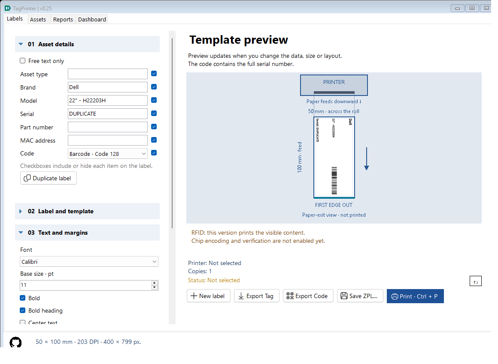
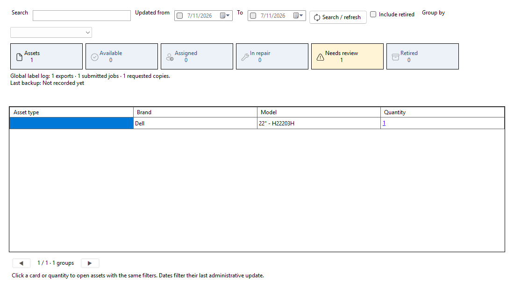

# TagPrinter

Windows desktop application for inventory labels, local event history and reporting.

**C# · WinForms · .NET 8 · SQLite · Windows x64 · English/Spanish UI**

## Download

[Download the portable release](https://github.com/dafermen/TagPrinter/releases/latest). Extract the entire ZIP and open **TagPrinter.exe**. The .NET runtime and SQLite are included. Install the printer's Windows driver separately.

Open the root executable; app/ contains the verified payload. Edit config.json at the root. See [startup validation](docs/STARTUP_VALIDATION.md).

## Current features — 0.16

- Asset type, brand, model, serial, part number and MAC address, with inline visibility controls.
- Optional QR/Code128, text-only labels, preset/custom media and four layouts.
- Installed fonts, point size, bold, automatic/manual fitting, margins/offsets, media orientation and full-content rotation.
- Automatic last-work restoration, New asset and visible print destination/copy summary.
- Full-label/code PNG export, raster ZPL export and Windows-driver/RAW-ZPL submission.
- SQLite event snapshots; Reports search/filter/sort/load, CSV, backup and reversible deletion/restoration.
- Dashboard groups latest matching unique serials by type/brand/model, separate from event/job/copy counts.
- Collapsible sections and remembered English/Spanish interface language; lower-left GitHub About link.






## Documentation

All source comments and project documentation are in English. The interface remains bilingual. Manuals describe current behavior; CHANGELOG holds release history.

| Document | Read it for |
|---|---|
| [Documentation index](docs/README.md) | Suggested paths for users, students and maintainers. |
| [User guide](docs/USER_GUIDE.md) | Creating, formatting, exporting and printing labels. |
| [Student guide](docs/STUDENT_GUIDE.md) | C# concepts, function contracts, variables/units and complete data flow. |
| [Architecture](docs/ARCHITECTURE.md) | Component responsibilities and persistence boundaries. |
| [Configuration](docs/CONFIGURATION.md) | JSON options, data paths, indexes and compatibility. |
| [History and Dashboard](docs/HISTORY.md) | Schema, querying, CSV, recycle bin, backups and count semantics. |
| [Troubleshooting](docs/TROUBLESHOOTING.md) | Runtime, printers, fitting, scans and data recovery. |
| [Validation](docs/VALIDATION.md) | Automated evidence and hardware limits. |
| [Changelog](docs/CHANGELOG.md) | Release history. |
| [Status](docs/STATUS.md) / [Roadmap](docs/ROADMAP.md) | Completed work and pending proposals. |

## Develop

Use Windows and the .NET 8 SDK:

```powershell
dotnet restore TagPrinter.sln
dotnet build TagPrinter.sln -c Release
dotnet run --project src/TagPrinter
./scripts/Test.ps1
./scripts/Publish.ps1
```

The project emits an XML API documentation file alongside build output for editor/tooling use. Source comments explain every explicit class/record and method, saved properties, meaningful state and complex algorithms. Read the student guide before changing rendering or persistence.

Publish builds and verifies the self-contained executable, then creates artifacts/TagPrinter-v0.16-PORTABLE-Windows-x64.zip. Generated outputs and personal databases are excluded from Git. Distribute the entire portable folder.

## Data

| File | Location | Purpose |
|---|---|---|
| config.json | Beside EXE | Installation media/defaults. |
| settings.json | %LOCALAPPDATA%/InventoryLabels | Last edited work; compatible historical location. |
| TagPrinter.db | %LOCALAPPDATA%/TagPrinter | Events, saved designs and recycle bin. |

Updates do not replace user history. Last work overrides startup defaults. Database backups do not include external images/ZPL, installation config or last-work settings.

## Limits

RFID chip encoding/verification is not implemented. Submission does not confirm physical printing. Validate a real printed sample and scan before a batch. History loading never prints automatically. Dashboard summarizes recorded serials/actions, not verified inventory. There is no permanent-delete, bulk import, synchronization or database encryption.

## License

TagPrinter source code and project documentation are licensed under the [MIT License](LICENSE).
Copyright (c) 2026 Dario Meneses.

Third-party libraries, bundled runtimes and GitHub artwork retain their own licenses and notices. The project MIT license does not replace their terms or grant rights to third-party trademarks.

## Dependencies and artwork

- ZXing.Net 0.16.11: https://github.com/micjahn/ZXing.Net — Apache-2.0.
- Microsoft.Data.Sqlite 8.0.28 / SQLitePCLRaw: embedded provider/native engine distributed through NuGet.
- .NET runtime: https://github.com/dotnet/runtime/blob/main/LICENSE.TXT — license and notices.
- Official GitHub mark: https://brand.github.com/foundations/logo — used as the project link. GitHub marks belong to GitHub, Inc.; no affiliation or endorsement is implied.
