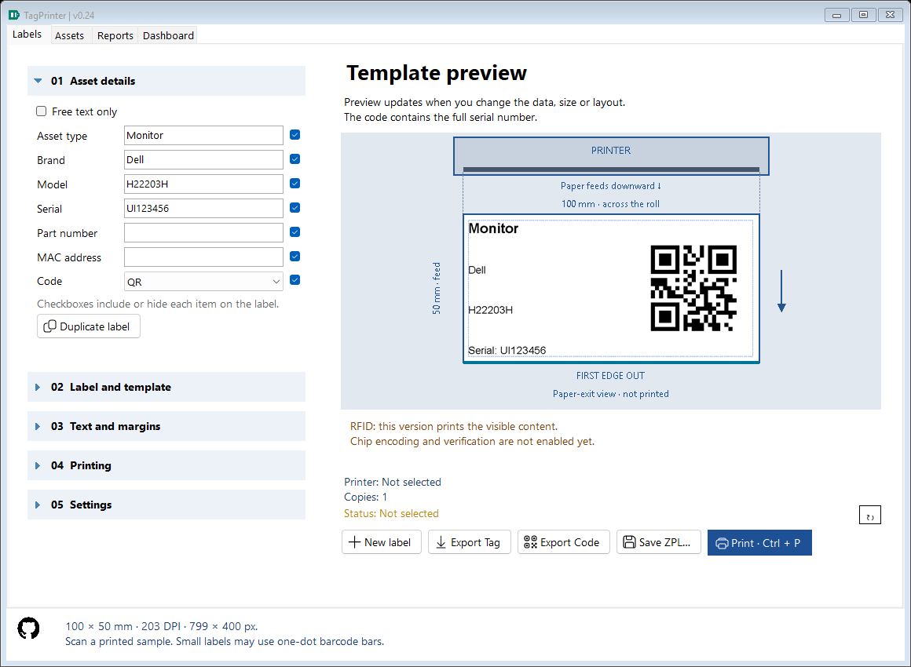
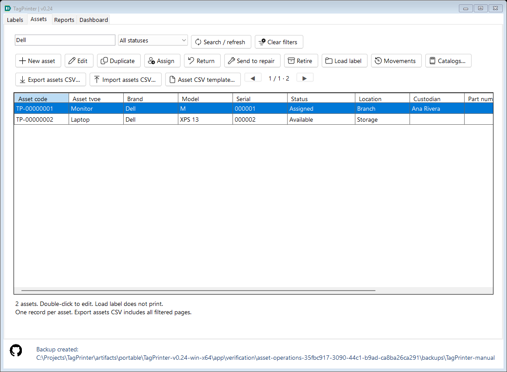
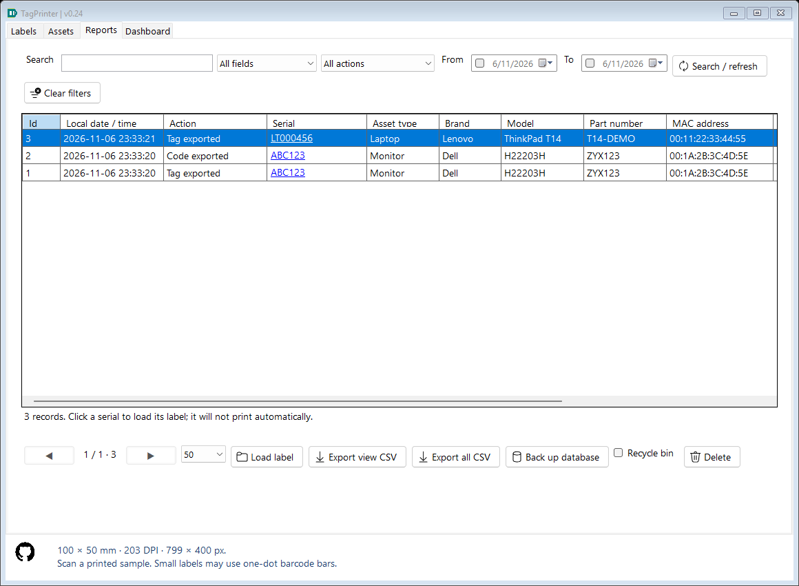
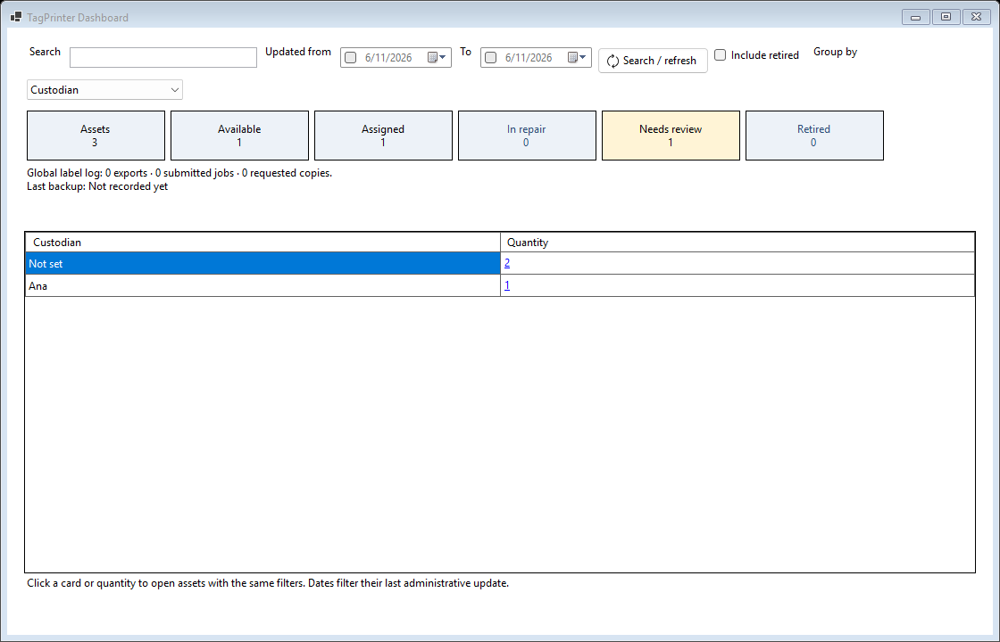

# TagPrinter

Windows desktop application for inventory labels, local asset administration and reporting.

**C# · WinForms · .NET 8 · SQLite · Windows x64 · English/Spanish UI**

## Download

[Download the portable release](https://github.com/dafermen/TagPrinter/releases/latest). Extract the entire ZIP and open **TagPrinter.exe**. The .NET runtime and SQLite are included. Install the printer's Windows driver separately.

Open the root executable; app/ contains the verified payload. Edit config.json at the root. See [startup validation](docs/STARTUP_VALIDATION.md).

See [full configuration transfer and code size](docs/CONFIGURATION_TRANSFER.md) for Settings export/import and 25–200% symbol scaling.

See [centering, empty recycle bin and Windows status](docs/TEXT_TRASH_PRINTER_STATUS.md) for the latest usability options.

## Current features — 0.24

- Asset type, brand, model, serial, part number and MAC address, with inline visibility controls.
- Optional QR/Code128, text-only labels, preset/custom media and four layouts.
- Installed fonts, point size, bold, automatic/manual fitting, margins/offsets, media orientation and full-content rotation.
- Automatic last-work restoration, New label and visible print destination/copy summary.
- Full-label/code PNG export, raster ZPL export and Windows-driver/RAW-ZPL submission.
- SQLite event snapshots; Reports search/filter/sort/load, CSV, backup and reversible deletion/restoration.
- Assets: stable internal codes, editable records, location, custodian, state, notes and movement history.
- Dashboard groups current master assets by type/brand/model and state, separately from global label-log counts.
- Previewed CSV inventory import, SQL pages, validated restore, automatic backups and reusable label profiles.
- Fluent icon/text actions and a visible Print · Ctrl + P shortcut.
- Serial recognition with explicit loading, inventory catalogs, guided assignment/return/repair, reviewed administrative CSV and visible backup status.
- Collapsible sections and remembered English/Spanish interface language; lower-left GitHub About link.









## Documentation

All source comments and project documentation are in English. The interface remains bilingual. Manuals describe current behavior; CHANGELOG holds release history.

| Document | Read it for |
|---|---|
| [Documentation index](docs/README.md) | Suggested paths for users, students and maintainers. |
| [User guide](docs/USER_GUIDE.md) | Creating, formatting, exporting and printing labels. |
| [Student guide](docs/STUDENT_GUIDE.md) | C# concepts, function contracts, variables/units and complete data flow. |
| [Daily operations](docs/ASSET_OPERATIONS.md) | Catalogs, assignment/return/repair, administrative CSV, Dashboard links and backup feedback. |
| [Assets](docs/ASSETS.md) | Local master records, assignment/location, movement history and upgrade safety. |
| [Interface refresh](docs/UI_REFRESH.md) | Shortcut presentation, offline Fluent buttons and attribution. |
| [Architecture](docs/ARCHITECTURE.md) | Component responsibilities and persistence boundaries. |
| [Configuration](docs/CONFIGURATION.md) | JSON options, data paths, indexes and compatibility. |
| [History and Dashboard](docs/HISTORY.md) | Schema, querying, CSV, recycle bin, backups and count semantics. |
| [Troubleshooting](docs/TROUBLESHOOTING.md) | Runtime, printers, fitting, scans and data recovery. |
| [Validation](docs/VALIDATION.md) | Automated evidence and hardware limits. |
| [Changelog](docs/CHANGELOG.md) | Release history. |
| [Status](docs/STATUS.md) / [Roadmap](docs/ROADMAP.md) | Completed work and pending proposals. |

## Develop

Use Windows and the .NET 8 SDK:

```powershell
dotnet restore TagPrinter.sln
dotnet build TagPrinter.sln -c Release
dotnet run --project src/TagPrinter
./scripts/Test.ps1
./scripts/Publish.ps1
```

The project emits an XML API documentation file alongside build output for editor/tooling use. Source comments explain every explicit class/record and method, saved properties, meaningful state and complex algorithms. Read the student guide before changing rendering or persistence.

Publish builds and verifies the self-contained executable, then creates artifacts/TagPrinter-v0.24-PORTABLE-Windows-x64.zip. Generated outputs and personal databases are excluded from Git. Distribute the entire portable folder.

## Data

| File | Location | Purpose |
|---|---|---|
| config.json | Beside EXE | Installation media/defaults. |
| settings.json | %LOCALAPPDATA%/InventoryLabels | Last edited work; compatible historical location. |
| TagPrinter.db | %LOCALAPPDATA%/TagPrinter | Asset masters/audit, label events/designs and recycle bin. |

Updates do not replace user history. Last work overrides startup defaults. Database backups do not include external images/ZPL, installation config or last-work settings.

## Limits

RFID chip encoding/verification is not implemented. Submission does not confirm physical printing. Validate a real printed sample and scan before a batch. History loading never prints automatically. Dashboard summarizes registered master data and label actions; it does not verify physical inventory. Permanent deletion is limited to confirmed history recycle-bin emptying; retire assets to preserve their records. RFID, synchronization and database encryption remain unimplemented. Schema 3 upgrades existing data after a protected backup; see the asset guide before rolling back to older binaries.

## License

TagPrinter source code and project documentation are licensed under the [MIT License](LICENSE).
Copyright (c) 2026 Dario Meneses.

Third-party libraries, bundled runtimes and GitHub artwork retain their own licenses and notices. The project MIT license does not replace their terms or grant rights to third-party trademarks.

## Dependencies and artwork

- ZXing.Net 0.16.11: https://github.com/micjahn/ZXing.Net — Apache-2.0.
- Microsoft.Data.Sqlite 8.0.28 / SQLitePCLRaw: embedded provider/native engine distributed through NuGet.
- .NET runtime: https://github.com/dotnet/runtime/blob/main/LICENSE.TXT — license and notices.
- Microsoft Fluent System Icons: pinned embedded private font and glyph map, MIT; see [upstream notices](docs/THIRD_PARTY_NOTICES.md).
- Official GitHub mark: https://brand.github.com/foundations/logo — used as the project link. GitHub marks belong to GitHub, Inc.; no affiliation or endorsement is implied.

Flexible labels: wrapped headings, dedicated free text, code space reclamation and fixed printer/paper-exit reference. See [the guide](docs/FLEXIBLE_LABELS.md).

The [paper-exit preview](docs/PAPER_EXIT_PREVIEW.md) keeps a fixed printer and leading-edge reference while label content rotates.

Free text stays out of inventory history. Ctrl+P on Labels shares the print command, with a temporary [Windows job-progress notice](docs/PRINT_JOB_PROGRESS.md).

[Inventory tools](docs/INVENTORY_TOOLS.md): transactional CSV import, SQL history pages, SQLite restore/daily backups, reusable profiles, duplication and serial warnings. Local use; synchronization remains pending.

The [interface refresh](docs/UI_REFRESH.md) adds visible Ctrl+P and offline Fluent icon/text actions. The new second [Assets module](docs/ASSETS.md) manages canonical records, assignment, location, status and movement audit, independently of label events. Database schema 3 is upgraded with a protected prior backup.
