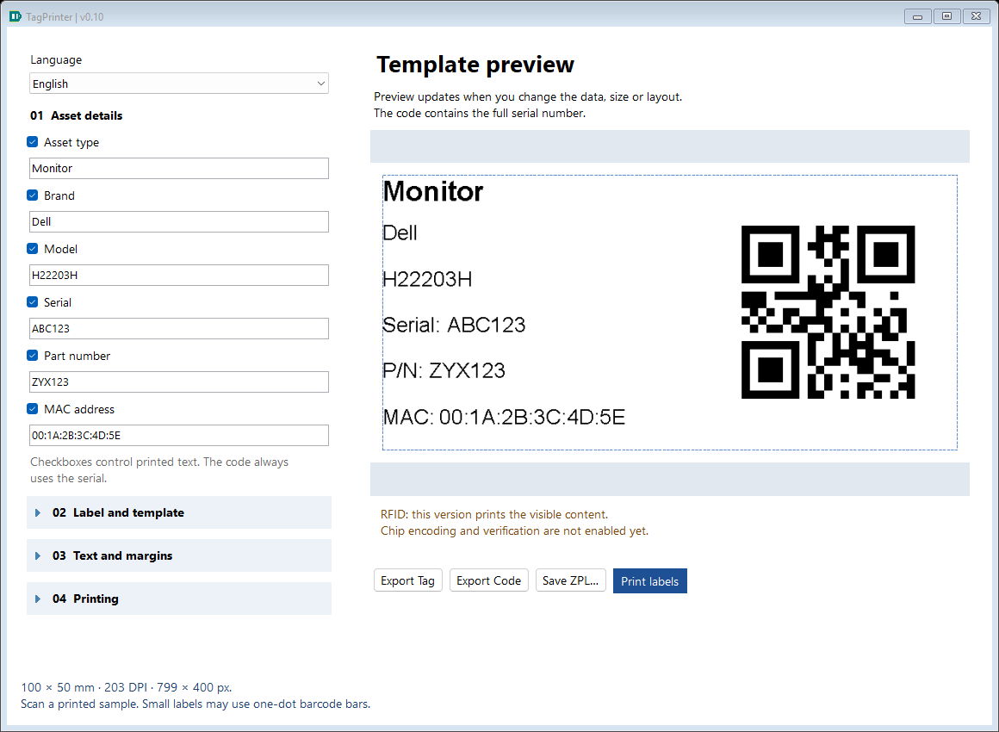
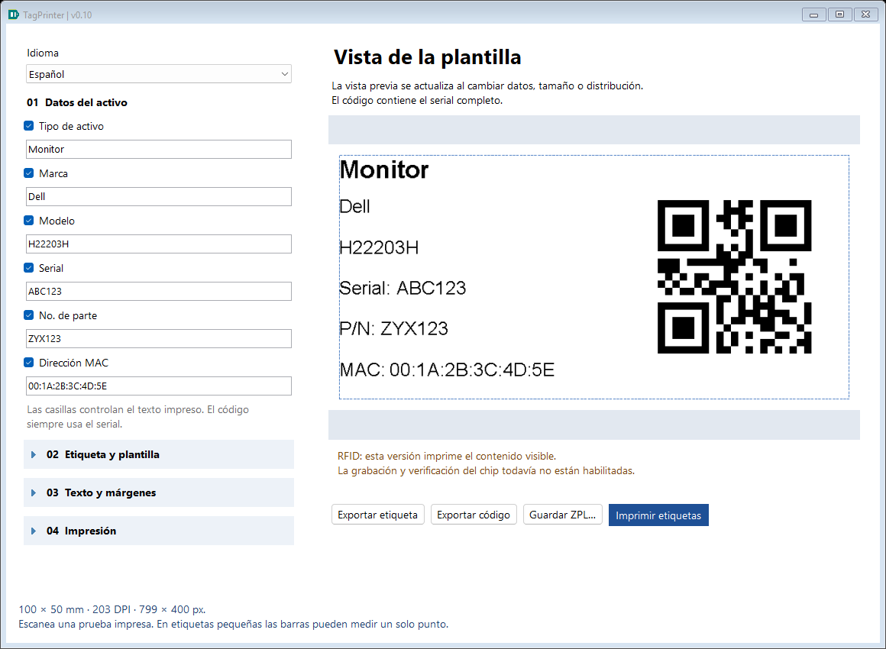

# TagPrinter

Windows desktop app for inventory labels / Aplicación de escritorio para etiquetas de inventario.

**C# · WinForms · .NET 8 · Windows x64 · English / Español**



## Download / Descargar

[Portable releases](https://github.com/dafermen/TagPrinter/releases/latest)

Extract the entire ZIP and open **TagPrinter.exe**. .NET is included. Install your printer's Windows driver separately.

Extrae todo el ZIP y abre **TagPrinter.exe**. Incluye .NET. Instala por separado el controlador de tu impresora en Windows.

## Features / Funciones

- Asset type / Tipo de activo, Brand / Marca, Model / Modelo, Serial, Part number / No. de parte and MAC address / Dirección MAC, each with its own visibility checkbox.
- QR or Code 128 containing the serial. Hiding the printed serial does not change the code.
- Label-size presets, custom dimensions, four layouts, font scaling, margins and print offsets.
- Collapsible settings sections, English/Spanish UI, automatic save and restore of the last work.
- **Export Tag**: complete PNG label. **Export Code**: standalone QR/barcode PNG with white quiet zones. ZPL export and Windows/RAW-ZPL printing.
- Editable **config.json** for label sizes and startup defaults.



## Configuration / Configuración

Edit **config.json beside TagPrinter.exe** and restart. In the source tree: [src/TagPrinter/config.json](src/TagPrinter/config.json).

The file defines label sizes and initial language, DPI, layout, code type, font and margin. The last work is saved separately in `%LOCALAPPDATA%\InventoryLabels\settings.json` and takes precedence over startup defaults.

Consulta la [guía de config.json](docs/CONFIGURATION.md) para ejemplos, límites y prioridad de los ajustes.

## Develop / Desarrollar

Windows with .NET 8 SDK and a desktop development environment:

```powershell
dotnet restore TagPrinter.sln
dotnet build TagPrinter.sln -c Release
dotnet run --project src/TagPrinter
```

Open `TagPrinter.sln` in Visual Studio, or run the commands above from this repository's root.

```powershell
powershell -ExecutionPolicy Bypass -File scripts/Test.ps1
powershell -ExecutionPolicy Bypass -File scripts/Publish.ps1
```

The publish script verifies the self-contained EXE and creates `artifacts/TagPrinter-v0.10-PORTABLE-Windows-x64.zip`. Generated output is not tracked in Git.

## Documentation

- [User guide / Guía de uso](docs/USER_GUIDE.md)
- [Configuration / Configuración](docs/CONFIGURATION.md)
- [Architecture / Arquitectura](docs/ARCHITECTURE.md)
- [Validation / Validación](docs/VALIDATION.md)
- [Changelog / Cambios](docs/CHANGELOG.md)
- [Status / Estado](docs/STATUS.md)
- [Roadmap / Próximos pasos](docs/ROADMAP.md)

## Limits / Límites

**RFID chip encoding and verification are not implemented.** This version prints only the visible content. A successful spooler submission does not confirm physical printing. Print and scan one real sample before printing batches. Small labels may require fewer visible fields or smaller fonts.

La selección de impresora usa dispositivos instalados en Windows. ZPL directo requiere un modelo compatible. Las medidas y calibración deben comprobarse con el material real. No incluye importación de inventario ni historial de todos los trabajos.

## Dependencies

ZXing.Net 0.16.11 — Michael Jahn and contributors — [Apache-2.0](https://www.apache.org/licenses/LICENSE-2.0), [project](https://github.com/micjahn/ZXing.Net).
.NET runtime — Microsoft and contributors — [license and notices](https://github.com/dotnet/runtime/blob/main/LICENSE.TXT).

Tipo de activo / Asset type aparece antes de Marca y tiene checkbox y autoguardado. Ejemplo: Monitor / Dell / H22203H / ABC123 / ZYX123 / 00:1A:2B:3C:4D:5E. El código representa ABC123. En trabajos existentes el nuevo campo empieza vacío para no inventar el tipo; completa su valor cuando corresponda.
