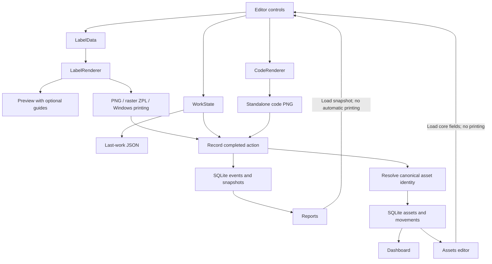

# Architecture — TagPrinter 0.23

TagPrinter is a Windows Forms application targeting .NET 8. It uses ZXing.Net 0.16.11 for symbols and Microsoft.Data.Sqlite 8.0.28 for embedded local storage. The Windows x64 portable bundles its runtime; printer drivers remain external.

## Component responsibilities

| File | Responsibility |
|---|---|
| src/TagPrinter.Launcher/Launcher.cs | Windows Framework launcher, embedded payload hashes and pre-runtime diagnostics. |
| StartupDiagnostics.cs | Mutable-data preflight, portable configuration root and startup logs. |
| AppWindow.cs | Normal windows with nonactivating/off-screen isolation only under --self-test. |
| Program.cs | STA WinForms startup, configuration/data errors, --self-test routing. |
| MainForm.cs | Editable controls, live preview, autosave, fonts, media, driver printing and export dialogs. |
| MainForm.History.cs | Tabs/footer, output recording, snapshot recovery and report/dashboard navigation. |
| AppConfig.cs | Validated installation presets and initial defaults. |
| WorkStore.cs | WorkState contract, last-work JSON and legacy migrations. |
| LabelRenderer.cs | LabelData contract, fitting, module painting, complete rotation and raster ZPL. |
| CodeRenderer.cs | Standalone symbol PNG with independent quiet zones/scaling. |
| HistoryStore.cs | SQLite initialization/connections/events/queries/trash/CSV/backup. |
| ReportsView.cs | Typed sortable projection, filters, recovery callback and history actions. |
| DashboardView.cs | SQL canonical groups/states and separate global label totals. |
| AssetStore.cs / AssetsView.cs | Transactional master/audit storage and paged administrative editor. |
| MainForm.Assets.cs | Stable selected identity and loading core fields into Labels. |
| FluentIcons.cs | Embedded private font/map and disposable per-button Fluent images. |
| Ui.cs | English/Spanish caption catalog and recursive control translation. |
| CollapsibleSection.cs | Accessible collapsible header/body. |
| RawPrinter.cs | Windows spooler P/Invoke and RAW submission lifecycle. |
| SelfTest.cs | Isolated integration/rendering checks and synthetic screenshots. |

## Data flow

Preview and output share geometry, but exported/printed labels exclude guides. Standalone export ignores full-label layout and ShowCode. Rendering and ordinary database/UI operations run synchronously; print submission and bounded queue observation use workers. ready/translating suppress reactive control events, not concurrent access.

## Persistence contracts

config.json defines installation defaults and stable media IDs. Existing last-work preferences override defaults. WorkState stores selection indexes for code/mode/DPI plus actual physical dimensions. LabelData holds actual DPI and rendering-only inputs. See [configuration](CONFIGURATION.md).

SQLite user_version is 2; protected migration upgrades version 1. events stores immutable action metadata plus complete JSON snapshots. trash stores reversible event membership; initialization adds it idempotently to older databases. Indexes cover serial and creation time. Foreign keys preserve loaded-source links. History serials are not unique; canonical assets separately enforce normalized nonempty serial uniqueness.

Connections use Pooling=false, WAL, foreign keys and a 5000 ms busy timeout. Queries bind input parameters and whitelist field expressions. Backup uses the SQLite backup API; CSV preserves values rather than localized display captions. See [history](HISTORY.md).

## Resource ownership and failures

Renderers return caller-owned Bitmaps. The preview disposes its previous image; output methods use scoped disposal. Reports/Dashboard dispose replaced DataTables. PrintDocument belongs to its caller. Native spooler scopes close with ownership flags and finally blocks.

Output must succeed before an event is appended. File/spooler output and SQLite are not one distributed transaction. Recording failure after output warns without automatic retry. Initialization distinguishes installation-config failures from data-folder/SQLite failures.

## Compatibility and limitations

The last-work path remains %LOCALAPPDATA%/InventoryLabels/settings.json. Legacy Title/ShowTitle migrate to Brand/ShowBrand only when replacement keys are absent. New properties use compatible defaults. Historical recovery uses Custom media to preserve dimensions, retains current language and clears missing printers.

CSV import and SQL pagination are implemented. RFID write/verification, synchronization and background rendering remain absent. Permanent deletion is limited to the history recycle bin after explicit confirmation; masters are retired. Dashboard counts canonical records and does not verify physical inventory. Driver behavior and scans require real hardware validation.

Read [the student guide](STUDENT_GUIDE.md) for an algorithm walkthrough and [validation](VALIDATION.md) for actual checks.

## Startup checks (0.16)

Open the root TagPrinter.exe to validate the immutable app/ payload before loading it. Editable config.json stays at the portable root; last work and SQLite are checked separately without deleting damaged data. See [startup validation](STARTUP_VALIDATION.md) for manifests, logs, recovery and limits.

## Configuration transfer — 0.18

ConfigurationTransfer.cs defines the versioned bundle, strict validation and staged paired persistence/rollback. MainForm.Configuration.cs owns import confirmation, local-resource fallback, pre-import backups and catalog refresh. ConfigurationTests.cs checks form round trips/restart, invalid input, rollback and resized symbol decoding. CodePercent is separate from FontPercent and is included automatically in snapshots/transfer. See CONFIGURATION_TRANSFER.md.

## Centering, recycle-bin purge and printer status — 0.18

03 Text and margins adds Center text for the whole text block. Reports > Recycle bin adds irreversible Empty recycle bin with all-filter scope confirmation. The visible printer summary now includes an automatically refreshed Windows status indicator. CenterText persists in work/history/full transfer; live status does not. See [centering, recycle-bin purge and Windows status](TEXT_TRASH_PRINTER_STATUS.md).

## Flexible layout — 0.19

LabelData includes a dedicated free-text source. LabelRenderer disables code for that mode, measures complete wrapped field heights, verifies that all characters fit, then assigns contiguous or spaced rectangles. Actual symbol dimensions determine text space after integral module scaling. MainForm.FeedGuide synchronizes physical size/visibility with PaperFeedPreview, which paints a fixed printer and leading-edge reference around the raster; the shared renderer never receives diagram state. WorkState stores free-text and physical-reference options; free-text output is excluded from new inventory history while its draft remains in autosave/configuration. See FLEXIBLE_LABELS.md.

## Fixed paper-exit preview — 0.20

PaperFeedPreview owns only paint logic around its inherited Image, not another render pipeline. It lays out physical media below a fixed printer and marks the bottom leading edge. MainForm.UpdatePaperPreview synchronizes size/visibility; the obsolete feed-direction control is removed, while legacy state is retained for file compatibility. Export and printing still use LabelRenderer directly. See PAPER_EXIT_PREVIEW.md.

## Inventory-only history and asynchronous print jobs — 0.21

MainForm.Printing routes Ctrl+P/button into one busy-gated command, captures state/provenance before any await, transfers bitmap/document ownership to a submission worker and correlates the result with a unique title plus optional RAW ID. WindowsPrintJobs bounds native reads; PrintJobTracker maps observations to transient UI states. Lifetime cancellation stops monitoring, never the submitted spooler job. RecordSnapshot skips Free text and HistoryStore.Add independently rejects those events; Query hides marked legacy rows. See PRINT_JOB_PROGRESS.md.

## Inventory tools — 0.22

InventoryServices defines strict CSV parsing, design-only LabelProfile helpers, transactional batch insertion, serial lookup, retained backups and staged restore. HistoryStore.Where binds shared search/group/trash criteria; Query optionally applies whitelisted global order and SQL LIMIT/OFFSET; Count avoids snapshot materialization. ReportsView.Paging holds transient navigation only. MainForm.Inventory owns explicit preview/confirm dialogs, profile/catalog atomic writes, backup timer and duplicate warning debounce. Profiles are settings; imported events are inventory; neither operation prints. Synchronization remains unimplemented by explicit local-only scope.

## Assets and Fluent actions — 0.23

AssetStore owns master/audit transactions, optimistic revisions, normalized serial identity and schema migration. History inserts resolve events.asset_uid without mutating immutable WorkState snapshots. Current label selection is optional WorkState.AssetUid; profiles strip it and Load history uses the authoritative event link. AssetsView provides paged SQL search/sort, explicit editing/retirement and field-level audit. Dashboard aggregates master JSON in SQL; label totals use a separate aggregate. FluentIcons uses a pinned embedded private font/map, DPI-sized per-button bitmap ownership and no runtime downloads. See ASSETS.md and UI_REFRESH.md.
