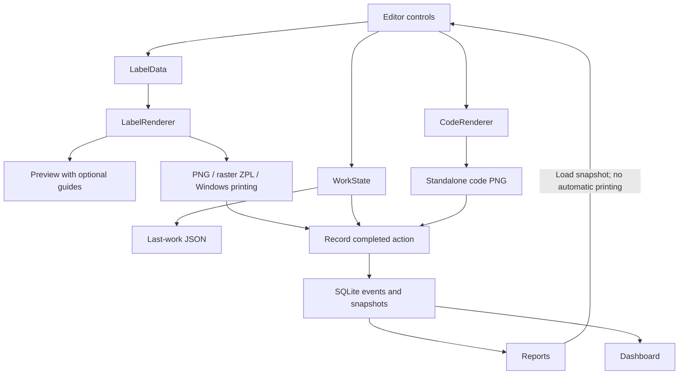

# Architecture — TagPrinter 0.16

TagPrinter is a Windows Forms application targeting .NET 8. It uses ZXing.Net 0.16.11 for symbols and Microsoft.Data.Sqlite 8.0.28 for embedded local storage. The Windows x64 portable bundles its runtime; printer drivers remain external.

## Component responsibilities

| File | Responsibility |
|---|---|
| src/TagPrinter.Launcher/Launcher.cs | Windows Framework launcher, embedded payload hashes and pre-runtime diagnostics. |
| StartupDiagnostics.cs | Mutable-data preflight, portable configuration root and startup logs. |
| Program.cs | STA WinForms startup, configuration/data errors, --self-test routing. |
| MainForm.cs | Editable controls, live preview, autosave, fonts, media, driver printing and export dialogs. |
| MainForm.History.cs | Tabs/footer, output recording, snapshot recovery and report/dashboard navigation. |
| AppConfig.cs | Validated installation presets and initial defaults. |
| WorkStore.cs | WorkState contract, last-work JSON and legacy migrations. |
| LabelRenderer.cs | LabelData contract, fitting, module painting, complete rotation and raster ZPL. |
| CodeRenderer.cs | Standalone symbol PNG with independent quiet zones/scaling. |
| HistoryStore.cs | SQLite initialization/connections/events/queries/trash/CSV/backup. |
| ReportsView.cs | Typed sortable projection, filters, recovery callback and history actions. |
| DashboardView.cs | Filtered event summary and latest-per-serial group counts. |
| Ui.cs | English/Spanish caption catalog and recursive control translation. |
| CollapsibleSection.cs | Accessible collapsible header/body. |
| RawPrinter.cs | Windows spooler P/Invoke and RAW submission lifecycle. |
| SelfTest.cs | Isolated integration/rendering checks and synthetic screenshots. |

## Data flow

Preview and output share geometry, but exported/printed labels exclude guides. Standalone export ignores full-label layout and ShowCode. The UI thread performs these operations synchronously; ready/translating suppress reactive control events, not concurrent access.

## Persistence contracts

config.json defines installation defaults and stable media IDs. Existing last-work preferences override defaults. WorkState stores selection indexes for code/mode/DPI plus actual physical dimensions. LabelData holds actual DPI and rendering-only inputs. See [configuration](CONFIGURATION.md).

SQLite user_version remains 1. events stores immutable action metadata plus complete JSON snapshots. trash stores reversible event membership; initialization adds it idempotently to older databases. Indexes cover serial and creation time. Foreign keys preserve loaded-source links. No unique constraint exists on serial.

Connections use Pooling=false, WAL, foreign keys and a 5000 ms busy timeout. Queries bind input parameters and whitelist field expressions. Backup uses the SQLite backup API; CSV preserves values rather than localized display captions. See [history](HISTORY.md).

## Resource ownership and failures

Renderers return caller-owned Bitmaps. The preview disposes its previous image; output methods use scoped disposal. Reports/Dashboard dispose replaced DataTables. PrintDocument belongs to its caller. Native spooler scopes close with nested finally blocks.

Output must succeed before an event is appended. File/spooler output and SQLite are not one distributed transaction. Recording failure after output warns without automatic retry. Initialization distinguishes installation-config failures from data-folder/SQLite failures.

## Compatibility and limitations

The last-work path remains %LOCALAPPDATA%/InventoryLabels/settings.json. Legacy Title/ShowTitle migrate to Brand/ShowBrand only when replacement keys are absent. New properties use compatible defaults. Historical recovery uses Custom media to preserve dimensions, retains current language and clears missing printers.

No RFID write/verification, inventory synchronization, bulk import, background rendering, pagination or permanent history deletion exists. Dashboard derives assets from event serials; it does not verify physical inventory. Driver behavior and scans require real hardware validation.

Read [the student guide](STUDENT_GUIDE.md) for an algorithm walkthrough and [validation](VALIDATION.md) for actual checks.

## Startup checks (0.16)

Open the root TagPrinter.exe to validate the immutable app/ payload before loading it. Editable config.json stays at the portable root; last work and SQLite are checked separately without deleting damaged data. See [startup validation](STARTUP_VALIDATION.md) for manifests, logs, recovery and limits.
