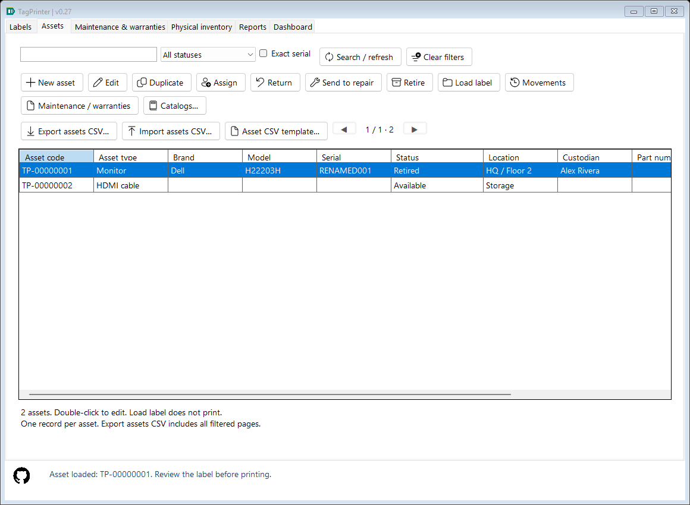
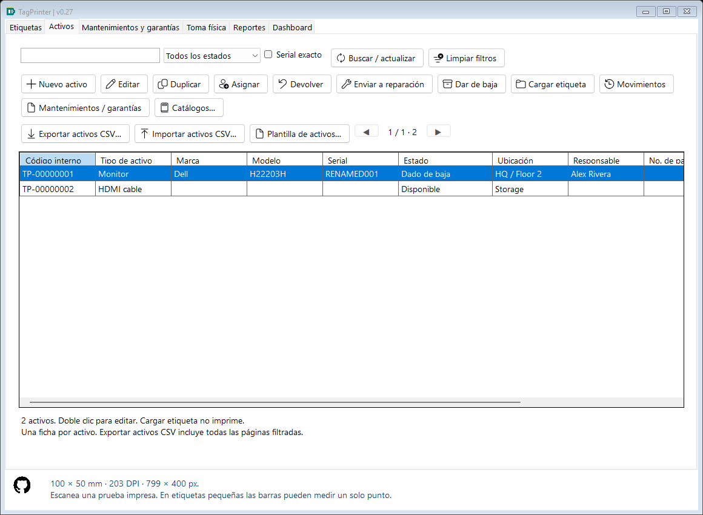
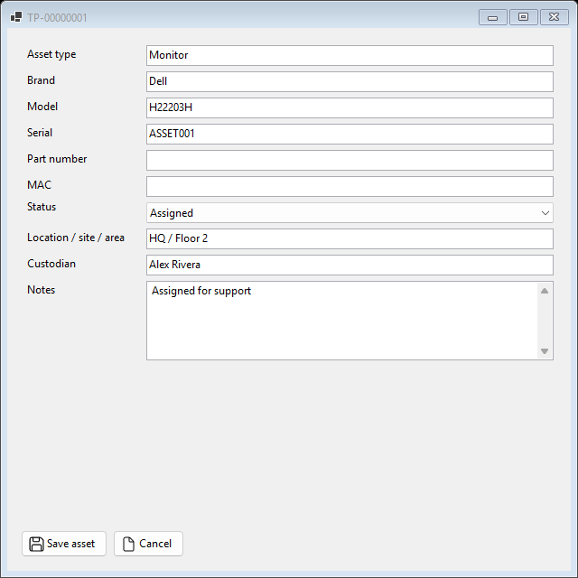

# Asset administration — 0.25

## Assets are independent records

The second tab, **Assets / Activos**, holds one canonical record per asset. Labels, imports and print submissions remain separate immutable history events in Reports. Reprinting or exporting an already registered asset does not create another asset or overwrite its responsible person, location, state or current core metadata.

Each asset has a stable GUID internally and a local **TP-00000001** style code for users. The code/identity is independent of the serial and does not change when a serial is corrected. Nonempty serials are trimmed and compared case-insensitively with invariant Unicode casing; one nonempty serial belongs to one canonical asset, including retired assets. Multiple assets may have no serial because their internal IDs remain distinct.

## Start, edit, duplicate and retire

- New asset opens a record editor; saving registers it without printing anything.
- Edit (or double-click) opens type, brand, model, serial, part number, MAC, status, location/site/area, custodian and notes.
- Operational statuses are Available, Assigned, In repair and Retired. **Needs review** is also available for incomplete imported/legacy administration data. Assigned requires a custodian.
- Duplicate starts a new record with the same core description and clears serial, part number, MAC, assignment/location/notes and identity. Review and save it explicitly.
- Retire preserves the record, stable code, audit and all label links. Edit its status to reactivate it. There is no permanent asset-deletion command.

The asset list searches actual field values or internal code, filters by status and reads SQL pages of 50 records. Header sorting is applied globally using whitelisted stored values, with newest updates first initially. Clear filters exits a Dashboard group. The current design/profile remains in the Labels workspace; it is not copied into the master record.

## Assignment and movement history

Saving changes writes the asset and an append-only movement in one SQLite transaction. Movements shows changed fields, old/new values, local date/time and the local account recorded by the application. Responsible person, location and status changes are retained as well as corrections to core identity data. This attribution is not a login/permissions system or tamper-proof audit service.

If another window/instance has edited the record since it was opened, saving is rejected rather than silently overwriting that change. Reload the asset to review the newer values. An unchanged save does not add an artificial movement.

## Label an asset

Select a record and use **Load label**. It copies only the six core asset fields into the current label design, selects Labels and never prints automatically. Then choose a profile/format and Print or Ctrl + P. For an asset without a serial, the code is disabled on loading so a text-only label can be produced; this release still encodes the serial when a code is enabled, not the internal TP code.

Label events store a separate stable asset reference. Loading/reprinting an old label keeps that identity even if the master serial has since changed, without restoring old metadata over the current master. Manually changing the serial in the label editor detaches the previous selected identity; a new output resolves/registers the serial normally. New/duplicate drafts also clear the selection. Profiles strip asset identity; applying one preserves the current selection.

In the Labels tab, New label starts a draft; Assets > New asset registers a master record. Normal inventory outputs and CSV imports register a previously unknown nonempty serial once, initially **Needs review**; existing masters remain unchanged. Use Assets > Edit for administrative updates. Unchecking CSV duplicate skipping records repeated Imported snapshots but does not overwrite an existing master. Free text creates neither label-history nor asset records.

Unlinked historical text-only entries with blank serials are not automatically treated as new physical assets: the application cannot infer whether they represent one device or repeated labels. Register such an asset explicitly and load its label from Assets when a stable link is required.

## Dashboard

Dashboard now counts current master records, not latest print snapshots. Search and optional dates filter asset field values and each asset's last administrative update. Groups show type + brand + model, location or custodian. State cards distinguish available, assigned, repair, retired and needs-review records. Retired records are excluded initially; Include retired adds them. Clicking a state card/quantity or double-clicking a group opens Assets with matching search/date/group/retirement criteria. Clear filters removes that scope.

The second summary line keeps **global active label-log totals** for tag exports, submitted jobs and requested copies. These are independent of the asset filters and do not confirm physical output or verified ownership. SQL aggregation avoids materializing every label snapshot just to count it.

## Updating an existing installation

Inventory SQLite schema is now version **5**, in the same user database. Before upgrading a version-1 database, the app creates a protected **backups/TagPrinter-before-assets-...db** copy. A schema-2 upgrade preserves **backups/TagPrinter-before-catalogs-...db**. A schema-3 upgrade preserves **backups/TagPrinter-before-services-...db**. All use consistent SQLite backup and are outside automatic ten-file pruning.

Migration is transactional: it creates master/audit tables and a nullable stable asset link on events. It derives one master from the newest active inventory snapshot per normalized nonempty serial, excluding recycled-only and Free text work. The initial state is **Needs review**, with no invented responsible person/location. A Migrated audit entry records this derivation. Original event IDs, snapshot JSON, dates, source links and recycle-bin membership are retained. It runs once, not on every startup. Large legacy histories may take time to migrate; keep the application open until it completes.

Existing backups with schema 1, 2, 3 or 4 can be restored: the chosen file is not modified; a staged copy is validated, upgraded and validated again before replacing live pages. Current schema-5 backups include assets, movements/reasons, vocabulary, label events, recycle-bin membership, maintenance, warranties, physical counts and their complete evidence together. The pre-restore safety copy includes all current records. Configuration/profile JSON and exported files remain separate.

Older binaries reject schema 5. Preserve current data and use the protected prior-version copy matching the older executable for rollback; later changes are not contained in that copy. Close other TagPrinter instances before upgrading/restoring. Synchronization remains pending. See [Maintenance and warranties](SERVICES.md) for schema-4 migration and recovery.

## Implementation and evidence

AssetStore owns validation, serial normalization/uniqueness, optimistic revisions, atomic core/audit writes, canonical grouping and migration. HistoryStore's shared insert resolves a stable master link in the same transaction as the label event, without changing its historical WorkState. MainForm.Assets loads core identity into the existing renderer; AssetsView coordinates explicit edits and readable field-level movements. No imported/edited/retired record is automatically printed.

AssetTests uses real isolated SQLite to check repeated outputs, serial edits and historical reprints, assignment requirements, real editor binding/save, stale and duplicate rejection, no-serial links, Free text exclusion, retired Dashboard filters, literal field search, protected Unicode-aware version-1 migration and schema-1/2 backup restoration. It also captures the bilingual UI. Physical printer validation and RFID remain pending.

Procurement, asset valuation/depreciation, attachments, structured employee/site entities, access roles and synchronization remain future scope. Location/custodian/type/brand/model now use editable vocabulary dropdowns. Settings CSV keeps six-field registration; Assets adds reviewed administrative CSV with UID/revision safeguards. Use SQLite backups for catalogs and complete movement recovery. See [Daily asset operations](ASSET_OPERATIONS.md).

Select **Maintenance / warranties** on an asset to open its linked service lists. View asset in that module returns to the exact stable asset identity, including blank-serial assets. Service state changes do not silently change asset custody or lifecycle.

Physical-count evidence freezes the expected asset scope and does not move masters or infer custody/state. Use View asset for explicit current administration. Schema-4 upgrades add a protected before-counts copy; see [Physical inventory](PHYSICAL_INVENTORY.md).
