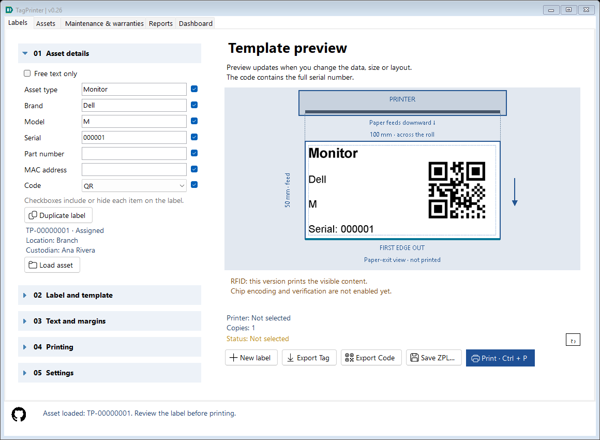
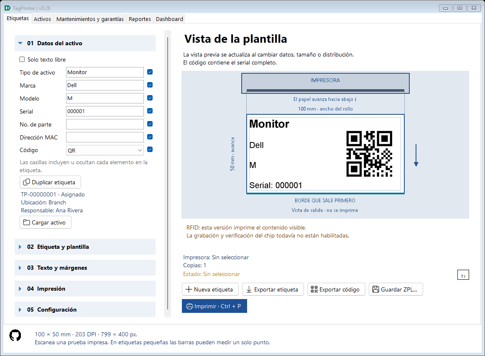
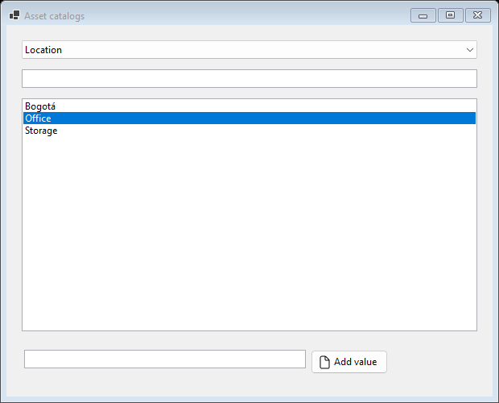
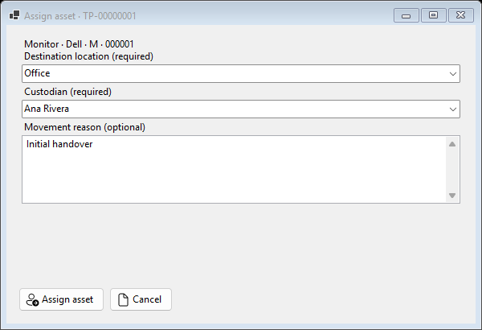
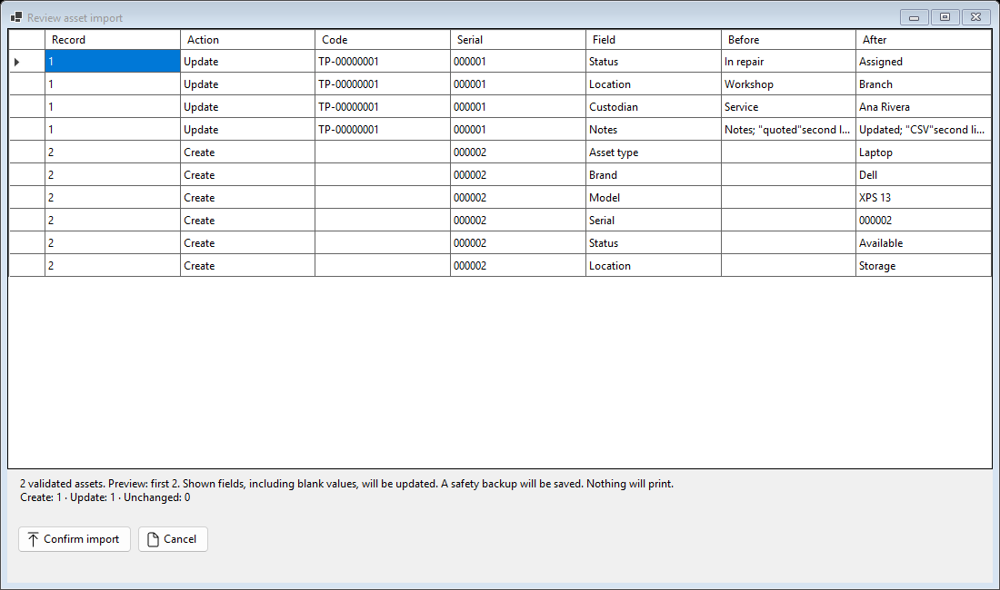
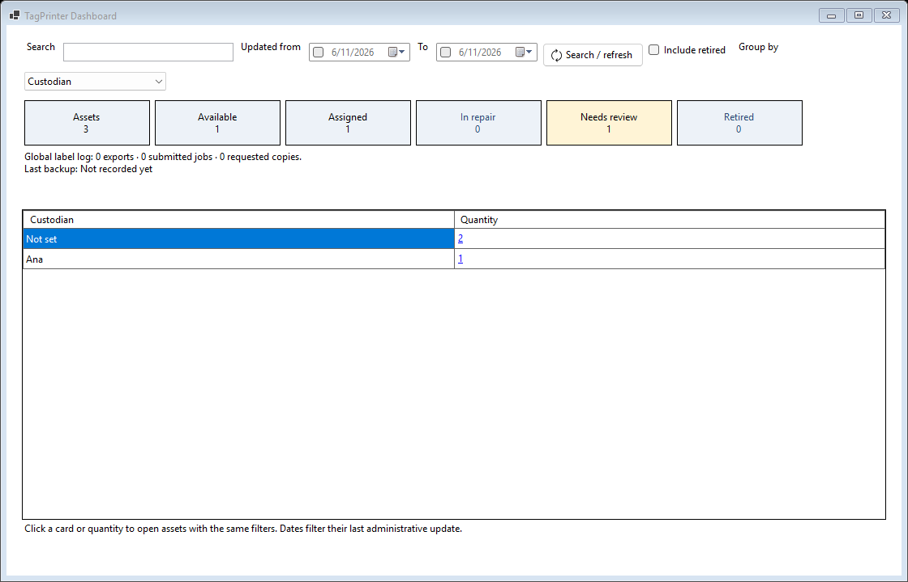
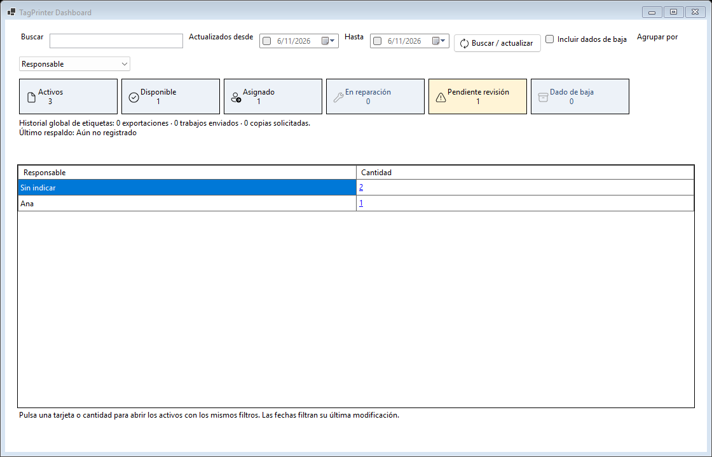

# Daily asset operations — TagPrinter 0.24

## Find an asset while preparing a label

Labels uses **New label / Nueva etiqueta** and **Duplicate label / Duplicar etiqueta** for drafts. Assets uses **New asset / Nuevo activo** to register a physical asset independently of printing.

Typing a serial checks the canonical inventory after a short delay. A match shows its internal TP code, current status, location and custodian, including retired records. **Load asset / Cargar activo** explicitly loads the current master details into the existing label design. The app resolves the serial again when clicked. Recognition alone leaves the draft intact. Review before printing; lookup/loading creates no event or movement.

Type, brand and model inputs offer catalog autocomplete. The QR/barcode continues to encode the serial.





## Reusable vocabulary

Assets > **Catalogs** maintains options for asset type, brand, model, location and custodian. Select a kind, enter a name and Add value. Asset editors and guided actions use editable dropdowns: choose an option or type a new value. A successful save learns new values in the same transaction as the asset.

Lookup keys use trim plus invariant uppercase. An existing key reuses its first saved spelling, so Dell / DELL / dell resolve to the same option in future saves. Blank values remain blank; field-specific length limits apply. Options persist even when unused. Existing master/history data is not silently rewritten during migration. Editing a master applies current vocabulary and audits any resulting change. Misspellings with different letters still require review.

Catalogs are inventory data inside SQLite and travel with database backups/restores. Full application configuration JSON transfers label presets/profiles/preferences; it does not transfer inventory vocabulary, asset records or movements. Custodian names are local display values; an employee account/permissions system remains a separate future feature.



## Assign, return and send to repair

Select an asset and choose **Assign**, **Return** or **Send to repair**. The dialog shows the selected identity and requests a destination location. Assigned requires a custodian. Return sets Available and clears the current custodian; the prior person/location remain in movement history. Repair sets In repair and permits a custodian/service provider. Retired assets must first be reactivated through Edit.

The optional reason belongs to that movement, separately from persistent asset Notes. It accepts 1000 characters. A reason-only explicit action is retained; an unchanged ordinary Edit save creates no extra movement. Each action writes master revision, before/after values, action, reason, local-account attribution and UTC time atomically. A stale open editor/action is rejected; reload before trying again.



## Administrative CSV

Use **Assets > Asset CSV template** for creating records, **Export assets CSV** for editing existing records and **Import assets CSV** for the review/import workflow. This is separate from the six-field label-registration CSV in Settings.

Files use UTF-8, semicolons and stable English headers:

```text
AssetUid;AssetCode;Revision;AssetType;Brand;Model;Serial;PartNumber;MacAddress;Status;Location;Custodian;Notes
```

- AssetUid, AssetCode and Revision identify an exported local record and detect stale edits. Preserve them when updating it. A nonempty UID requires its exported Revision. An unknown identity is rejected; importing a foreign database's internal identity is not a merge.
- For a new record, leave those three metadata cells empty. Without a UID, a known nonempty serial resolves an existing record for review; an unknown serial creates one. New blank-serial records are explicit separate assets.
- All ten business headers are required to prevent accidental partial-field erasure. Shown blank values intentionally clear a field. Status uses Available, Assigned, Repair, Retired or Unspecified. Assigned requires a custodian.
- Treat serial, part number and MAC as text in spreadsheet software to preserve leading zeros. Quoted semicolons, quotes and multiline Notes round-trip.
- Limits: 10 MB / 10000 records per file; core field limits remain enforced. Repeated normalized serials/targets, conflicting owners, invalid statuses/values and stale revisions reject the file.

The review table totals Create / Update / Unchanged for the entire file and shows field-by-field **Before / After**. Preview displays the first 200 assets for bounded UI work; every row is validated and the full record count is shown. Close/cancel leaves inventory untouched. Confirmation first makes a protected before-asset-import backup, then commits the full plan in one transaction. Any stale record, changed catalog spelling or later write failure rolls back all asset/catalog/movement changes. Review values are normalized against an in-memory catalog snapshot before confirmation, without learning options in the database. Results report created, updated and unchanged counts. No label event or print job is created.

Export includes every asset matching the list's search/status/Dashboard scope across all pages, ordered by internal code. It streams rows instead of materializing the complete list. Use Clear filters before exporting the whole registry. CSV edits business fields; full SQLite backup/restore preserves movement history and catalogs as well.



## Dashboard navigation

Choose grouping by **Type / brand / model**, **Location** or **Custodian**. State cards and quantity links open Assets with the same search, last-update date range, retirement scope and exact raw group values. An empty location/custodian is shown as Not set and opens only that empty-value group. Clear filters in Assets removes the drill-down restrictions.

Needs review is highlighted for incomplete administration. Retired assets are excluded initially; Include retired adds them to cards/groups. Zero-count cards are disabled. Group sorting retains a hidden source key so a click still opens the correct group after sorting. Global label-log totals remain independent of asset filters.





## Backup feedback and Back up now

Dashboard shows the last recorded successful backup time and a notice when the latest attempt failed. Expand **05 Settings** for its full path, failure detail and **Back up now**. A missing last-success file is called out. Readable status is separate from an unrelated footer message.

Back up now creates a consistent TagPrinter-manual-...db under the database's backups directory, off the UI thread. Manual and protected pre-operation copies are outside automatic ten-copy pruning. Daily automatic copies retain their existing policy. Failed attempts preserve the previous successful path/time; a later success clears the failure. Status is best-effort operational metadata, not proof of a restore test or remote/off-machine protection.

Metadata lives beside the database as TagPrinter.db.backup-status.json. It is local to this installation's data path and stays outside SQLite restoration so restoring inventory cannot rewind machine backup feedback. Existing installations without metadata initially show Not recorded yet; a new successful backup establishes it.

## Database compatibility

Current schema is **4**. Schema 3 introduced asset_catalog and movement notes; schema 4 adds maintenance/warranties and their immutable revisions. Startup preserves a protected before-assets (schema 1), before-catalogs (schema 2), or before-services (schema 3) copy before migration. Original master/label snapshots retain their identity and data.

Restore accepts schemas 1–4 through validated/upgraded/revalidated staging, without modifying the chosen source. Current snapshots include all inventory and service data. Older binaries reject schema 4; preserve the protected matching prior-version copy for rollback, which excludes later changes. Close other instances during upgrade/restore. See [Maintenance and warranties](SERVICES.md).

## Source walkthrough and evidence

AssetCatalog resolves reusable spellings within caller-owned transactions. AssetCsv parses a complete plan with before/after snapshots; AssetStore.ImportAssets rechecks each target inside one transaction before saving. AssetStore.Transition enforces guided action requirements. AssetFilter carries exact Dashboard/list/export criteria. A stable hidden group index prevents sorting from confusing navigation. BackupStatus records operational feedback independently of inventory restoration.

AssetOperationsTests exercises the actual catalog/assignment forms, explicit lookup, Unicode catalog normalization, reason-only actions, stale/invalid workflow rejection, CSV round trips/preview/transaction rollback/concurrency, complete filtered export, Dashboard scope equality, protected schema-2 migration, catalog/reason backup restoration and backup success/failure/missing-file/manual recovery. UI snapshots use isolated synthetic data and off-screen windows. A hidden host keeps the real WinForms message loop alive for asynchronous backup/print tests; translated commands and usable grid bounds are checked at the minimum window size. Physical printing and synchronization remain pending.

## Large local datasets — 0.25

Lists/aggregate groups/audit use bounded background pages and catalog pickers use up to 200 prefix options. Exact serial accelerates known-identifier lookup. Full master/history exports use cancellable streaming with a staged destination; master import vocabulary/identity lookup is prepared and lazy. See [Large histories and inventories](PERFORMANCE.md). The derived performance indexes remain in place with the schema-4 service extension.
