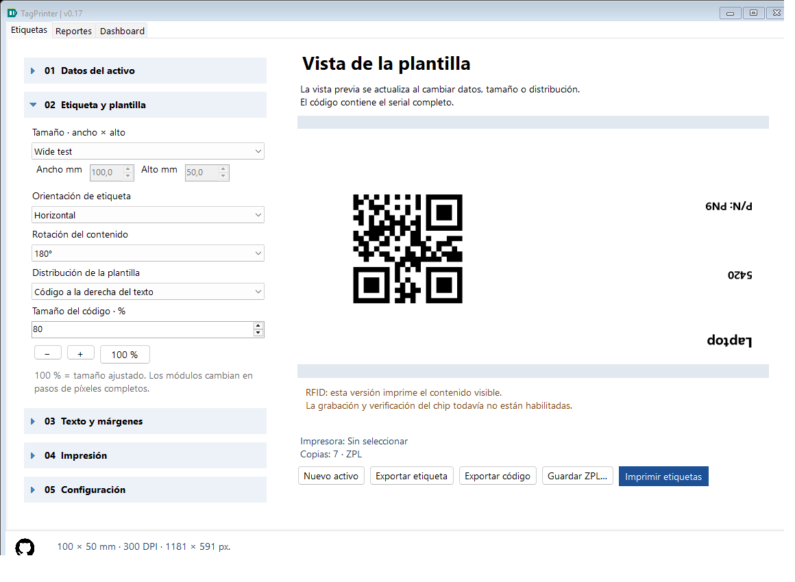
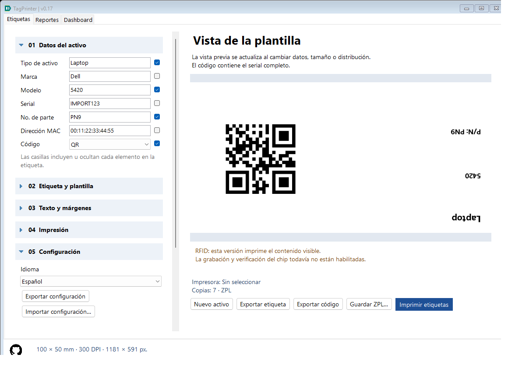

# Full configuration transfer and code size — 0.17

## Export and import

Expand **05 Settings**. Export configuration saves a versioned JSON envelope with the full active media catalog/startup defaults and every persisted WorkState preference: six asset values, inclusion flags, code type/size, media ID/dimensions, DPI/method/copies/printer name, language, font/base size/bold/fitting, margins/guides/offsets and whole-content rotation.

The export includes current unsaved editor values and unfinished drafts, not only the previous settings.json on disk. It may contain serials/MAC addresses and other asset data; review before sharing. It is plain JSON, not encrypted.

Import configuration validates the selected file and previews replacement scope before asking for confirmation. The plain installation config.json is not a full transfer file. Unknown transfer schema versions, missing required sections, oversized files (over 1 MB), invalid ranges and mismatched catalog/media are rejected before changing live files or controls.

After confirmation the application saves a full before-import backup under **%LOCALAPPDATA%/InventoryLabels/configuration-backups/**. It stages the new config.json and last-work settings.json before replacement. Ordinary write failures trigger rollback of any replaced file. The UI/catalog refresh immediately, and the settings survive restart. No printing or label-history event is triggered. The installed config destination must be writable; use an extracted portable folder with appropriate permissions. Close other application instances before importing.

The paired replacement is not a power-loss/distributed transaction. If interrupted between file replacements, use the before-import export for recovery. If rollback itself fails, the error explicitly points to that backup. Keep independent backups as well.

The imported catalog replaces the active catalog rather than merging IDs. Data and formatting replace the current editor. Source-event provenance is cleared to avoid attributing later output to an unrelated local history row. Missing printer selection stays empty even on restart; an unavailable font falls back to an installed font (normally Arial). The confirmation explains these local-resource substitutions. Review printer and preview before output.

## Scope boundaries

| Included | Not included |
|---|---|
| Complete application media/defaults and current editor preferences/data | SQLite events, report data, recycle bin or exported image/ZPL files |
| App-level printer name, method, DPI and requested copies | Driver installation, printer ports, firmware/calibration or native driver preferences |
| Font-family name and text settings | Font files or font installation |
| Code scale and template geometry | Application/runtime binaries, integrity manifests or Windows settings |

History uses Reports > Back up database. Full configuration transfer is not a database restore. Temporary report searches/date filters, current tab, window geometry and section expansion are not persisted configuration and are not transferred.

## Increase/decrease code size

Expand **02 Label and template**. **Code size · %** accepts 25–200 percent, with minus/plus (ten points) and 100% reset. 100% preserves the previous version's fitted full-label symbol. Older work/history without CodePercent defaults to 100.

For QR, whole-cell pixel size changes width and height together. For Code 128, whole-unit bar width and bar height change. Fractional modules are never stretched or blurred: some percentage changes therefore have identical module widths, and an extremely small setting can be rejected when even one pixel per module cannot be kept.

When enlarged, a side layout may borrow horizontal text space; a bottom layout may borrow vertical text space. Text still obeys its fitting rules. If code or text cannot fit safely inside the margins, preview shows an error instead of clipping. At 100% a dimension may already be at its limit; choosing a larger label/different layout can be necessary to enlarge further.

The selection affects preview, full-label PNG, ZPL and printing, and is stored in history/configuration exports. Export Code also uses the percentage, relative to its own standalone baseline, with proportional white quiet zones. It remains independent of label layout and ShowCode, so its physical size can differ from the symbol in a full label. Scan a real sample before batches, especially with reduced module widths.

## Implementation for students

ConfigurationBundle combines AppConfig with WorkState and explicit format/schema metadata. ConfigurationTransfer loads/validates, writes atomic single-file exports and stages/rolls back paired live-file replacements. MainForm.Configuration previews local printer/font availability, creates a backup from live values, installs resolved settings and rebuilds controls.

LabelRenderer computes the old fitted integer scale, multiplies by CodePercent, rounds down to whole modules, then checks/grows the reserved area along the layout's shared axis. CodeRenderer independently scales its baseline integer modules/bar height. CodePercent is an optional default-100 property in LabelData/WorkState/ConfigDefaults; existing snapshot and pixel behavior remains unchanged at 100.

ConfigurationTests uses real forms, separate paths/catalogs, before-import round trips, restart recovery, missing resources, rejection/rollback and pixel decoding at both DPIs. No printer submission or real user-state mutation is involved.
