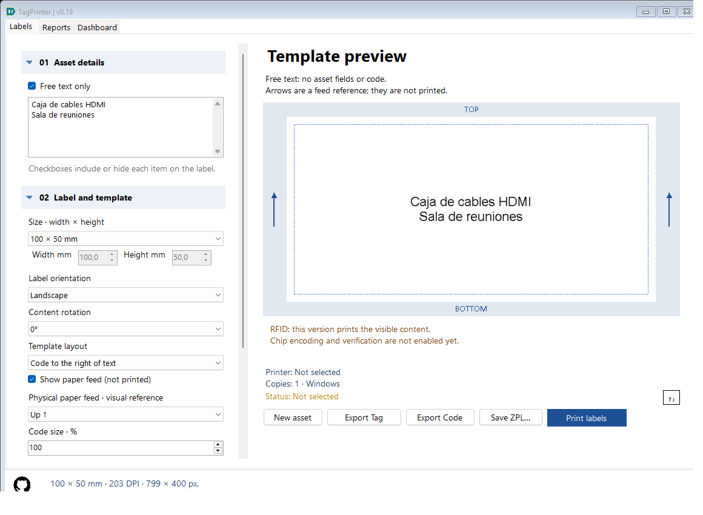

# Flexible text and paper-feed reference — 0.19

## Wrapped asset headings

Asset type wraps onto additional lines at the available text width. Its measured height is reserved before placing subsequent fields; the ending is not silently clipped. Automatic fitting can reduce the font to 50 percent. If complete content still cannot fit, the preview explains the overflow and disables printing. Enlarge the media, reduce the font or shorten the content. No finite label can hold unlimited text.

## Free text only

In 01 Asset details, enable **Free text only** and write up to 2000 characters, including explicit line breaks. Only this text is rendered: no asset fields, serial or symbol is required. Fonts, bold, centering, margins and content rotation still apply. Blank content is rejected. Switching modes keeps the asset editors' values in current work/autosave/configuration; **New asset** clears both sets of text.

A full-label output history snapshot stores the free text, a blank serial and no code, so Dashboard does not count the hidden asset identifier. The first 80 free-text characters appear as the report's Asset type description; the full text remains in StateJson and is restored for reprinting. Hidden asset values are not carried into that free-text output snapshot. Standalone Export Code remains independent and uses the asset serial; it requires a valid serial even in free-text mode.

## Space returned by smaller codes

The existing percentage still chooses whole-pixel modules relative to a fitted baseline. After choosing the actual symbol dimensions (including its quiet zones), the renderer gives the remaining width or height to text, with an additional gap. Reducing a right-side symbol releases width; reducing a bottom symbol releases height. Enlarging it consumes that space. Quiet zones are never removed and the bitmap is not stretched. A percentage change may produce the same width until the next integral module step, particularly for Code 128.

This intentionally changes text placement even at 100 percent if the old reservation exceeded the actual code size. Existing history/configuration retains its settings, but re-rendering uses the new layout. Standalone code output is unchanged.

## Paper-feed arrows

In 02 Label and template, **Show paper feed (not printed)** controls arrows in rails outside the label. Select Down, Up, Left or Right under **Physical paper feed · visual reference** to match the way your roll exits. TOP/BOTTOM identify preview edges. The initial reference is Down; this is not a printer measurement.

These are user-selected visual guides. They do not detect roll loading, change media dimensions, rotate content, configure Windows drivers or fix the pending physical-media/design-orientation issue. The direction stays attached to the physical preview when content rotates. PNG, ZPL and Windows print output contain no arrows or edge labels.

All new work settings survive autosave/restart, full configuration transfer and output-history restoration. Older saved work defaults to asset mode, empty free text, enabled feed guides and Down. Installation config.json does not introduce new free-text defaults.

## Implementation and verification

LabelRenderer measures wrapped field heights and uses actual symbol dimensions to allocate remaining space. MainForm.FeedGuide paints outside the PictureBox so export/print use the same undecorated raster as before. WorkState carries new fields with compatible defaults; configuration transfer bounds free text to 2000 characters and feed direction to 0–3.

LayoutImprovementsTests checks real pixels, the final character of a wrapped heading, text inside the reclaimed QR region, free-text field isolation, blank rejection, history/transfer/restart and byte-identical PNG output with guides on/off. Existing decode and rotation tests remain in the full suite. Physical printer/scanner confirmation is deferred until hardware is available.
