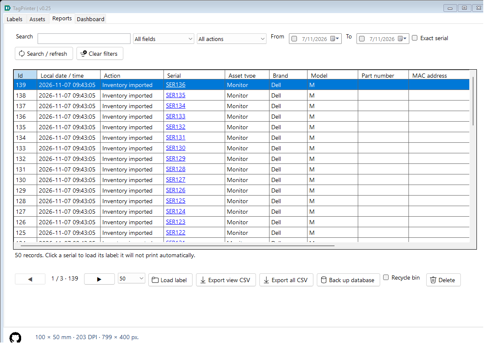
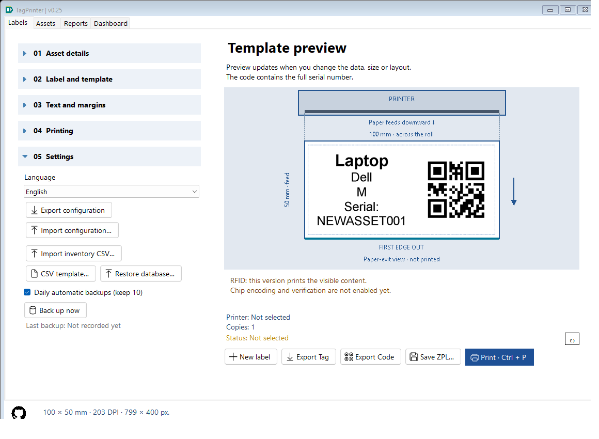
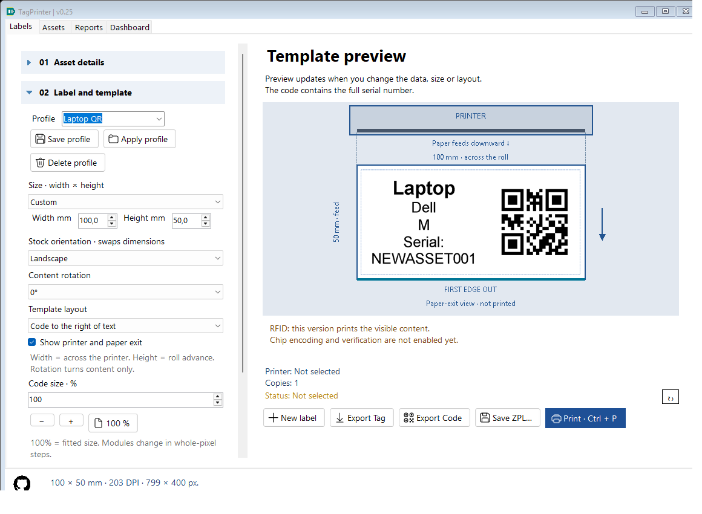

# Inventory tools — TagPrinter 0.25

## Import inventory without printing

Open **05 Settings > CSV template** to save an example. Use UTF-8 CSV with semicolons and these stable English headers:

```csv
AssetType;Brand;Model;Serial;PartNumber;MacAddress
Monitor;Dell;H22203H;000123;ZYX123;00:1A:2B:3C:4D:5E
```

Serial is required; other named columns are optional. Unknown columns are ignored, so the application's inventory report CSV can also supply these fields. Import uses the current label design, not report StateJson or printer settings. Keep serials as text in a spreadsheet so leading zeros are not removed before saving the CSV. Quotes, embedded semicolons and quoted newlines are supported. A file is limited to 10 MB / 10000 records; use multiple files for larger batches.

**Import inventory CSV** validates the entire file, then opens a read-only preview. Closing/canceling it writes nothing. Skip duplicates is initially checked: active serials already in the database and earlier rows in the same batch are omitted. Comparison trims input; canonical lookup uses invariant Unicode uppercase while legacy event matching uses SQLite ASCII folding. Active master serials also participate. Uncheck deliberately to register repeated inventory snapshots without overwriting a master. Free text does not block import. Recycling only a label does not retire its canonical asset.

After confirmation, a consistent pre-import backup is made and all accepted rows commit in one transaction as **Imported** actions. They appear in Reports and Dashboard without being counted as printed jobs or tag exports. There is no automatic printing. On validation/write failure the batch is rejected/rolled back; it is not partially imported. Invalid text lengths, missing serials, malformed CSV or invalid UTF-8 must be corrected first. Label rendering is checked when loading/printing; choose QR for non-ASCII serials.

## SQL-backed history pages

Reports displays 50 rows initially; choose 50, 100 or 250 and use the previous/next arrows. The page indicator shows page number, number of pages and total matching events. Search/date/action/recycle filters apply before pagination. Sorting a header applies to the whole matching dataset, not just the current page, using whitelisted stored SQL values and an ID tie breaker. Action ordering uses stored action codes rather than translated captions.

Filters reset to the first page; deleting records clamps an out-of-range page. Dashboard now opens Assets with its exact current search/date/retirement scope and description/location/custodian group; Reports retains its own history filters. Clear filters exits the group. **Export view CSV** exports the current page in displayed order; **Export all CSV** keeps its earlier meaning: every inventory event in the selected active/recycle scope, regardless of page/filter. Full history exports now stream scalar/raw snapshot rows with bounded memory, progress/cancel and staged destination replacement. Dashboard aggregates in SQL and materializes one group page rather than every group/event; cross-instance snapshot paging is not implemented.



## Database restoration

Open **05 Settings > Restore database** and choose a TagPrinter SQLite backup. Close other TagPrinter instances first; printing/tracking and an active automatic backup must finish. Confirmation explicitly replaces all events and recycle-bin membership, not last-work JSON, profiles, printer drivers, settings or external PNG/ZPL files.

The app stages a consistent read-only copy, checks SQLite integrity, version/tables, expected foreign keys/data links and readable event snapshots, and rejects unrelated/trigger-bearing/newer/corrupt files before touching live pages. It saves a separate **TagPrinter-before-restore-...db** safety copy, then restores through SQLite's transactional backup API. The editor keeps its draft but clears its historical and selected master references; Reports reloads. Safety copies are not automatically pruned. If validation fails, the current inventory remains unchanged.

This restores an inventory database, not a synchronization merge. Schema 1, 2 and 3 backups are supported; older schemas are upgraded only in staging. Choose a proper SQLite backup rather than copying a live WAL database file in Explorer. If startup rejects a corrupt live database, preserve it and follow TROUBLESHOOTING.md before using the restore UI in a working installation.

## Automatic backups

Daily automatic backups are enabled initially. The checkbox in 05 Settings controls daily copies, and is included in full configuration transfer. While the app runs, it checks at startup and hourly, creating at most one routine copy per UTC date in `%LOCALAPPDATA%/TagPrinter/backups` (beside a custom database for isolated/custom data). Only the ten newest files named **TagPrinter-auto-...db** are retained. Independently, confirmed imports force a pre-import copy in that retention group; restores always create protected safety copies, even when daily backups are disabled.

Automatic copying uses the SQLite API with separate connections, never an Explorer copy of the live DB. Failed daily attempts appear in the status area and may retry on the next timer tick. No backup timer runs against real user data during self-tests. Backups contain database events/trash, not configuration, profile JSON or exported files. Changes since the last successful copy are outside that backup; this is a daily policy, not continuous versioning. Copy important backups to another location separately if needed.

## Reusable label profiles

At the top of **02 Label and template**, type a profile name (1–60 characters) and Save profile. Save captures dimensions, code type/size, layout, font/bold/fitting, visibility, centering, offsets, rotation and preview preferences. It strips asset strings, free text and printer selection. Existing names require replacement confirmation. Up to 100 named profiles are supported.

Apply profile changes design while preserving the current six asset fields, free-text draft/mode, language, selected printer and copies. Saved dimensions are restored as Custom, independent of a catalog preset being renamed. Missing installed fonts follow the normal editor fallback. Delete profile removes only that saved design after confirmation; the current label remains unchanged.

Profiles and the daily-backup preference are persisted atomically in the editable root config.json. That location must be writable. Full configuration export/import includes them automatically; database restoration does not. Last-work autosave preserves the applied design, while the profile-name selection itself is a transient editor choice.

## Duplicate an asset and check serials

**01 Asset details > Duplicate asset** retains type, brand, model and formatting, clears Serial, Part number and MAC address, drops loaded-source provenance, and focuses Serial. Fill the new identifiers before printing; no inventory event is created just by duplication. The command is disabled in Free text mode.

A debounced inline warning appears when the serial matches active inventory (trimmed, ASCII case-insensitive). It is advisory: repeated printing/exporting the same asset is still allowed. Recycled and Free text records do not trigger it. Bulk import handles duplicates through its preview checkbox rather than one modal dialog per row.





## Local use and synchronization

The user confirmed local-only use for this release. Synchronization remains pending. No shared-folder database, cloud account, background upload or central server is configured. A future multi-device design must define a server/API, identity, permissions, offline operation and conflict resolution; restoring backups is not that design.

## Implementation for students

InventoryCsv parses and bounds input before any write. HistoryStore.ImportInventory reuses the normal parameterized insert inside one transaction, including duplicate checks against rows inserted earlier in the batch. HistoryStore.Where centralizes bound SQL criteria for Count and Query, whose optional LIMIT/OFFSET and whitelisted ORDER BY keep the report page bounded. ReportsView.Paging stores only transient navigation state.

InventoryServices also validates/stages backups and restores them via SQLite's backup transaction. AppConfig contains profiles and automatic-backup policy; MainForm.Inventory coordinates dialogs, timers and design-only application. No imported row is sent to a printer. InventoryToolsTests uses real isolated SQLite/CSV/forms to check rollback, quoted text, leading zeros, duplicates, page boundaries/global order/groups, backup retention, restoration/safety/invalid preservation, profile transfer and identity-clearing duplication.

SQLite transaction contract: [Online Backup API](https://www.sqlite.org/c3ref/backup_finish.html). Physical printer calibration/RFID verification remain separate hardware tasks.

Since 0.23, new nonempty serials also register a canonical asset in Needs review, in the same import transaction. Existing master metadata is not overwritten by repeated imports/label snapshots; edit it explicitly in Assets. Database backups include masters and movements. See ASSETS.md.

For master location/custodian/status/notes updates, use the separate Assets administrative CSV workflow in ASSET_OPERATIONS.md. The original Settings CSV still registers six-field label snapshots and remains compatible. New label / Duplicate label now identify draft commands; Assets New asset / Duplicate registers physical records explicitly.
