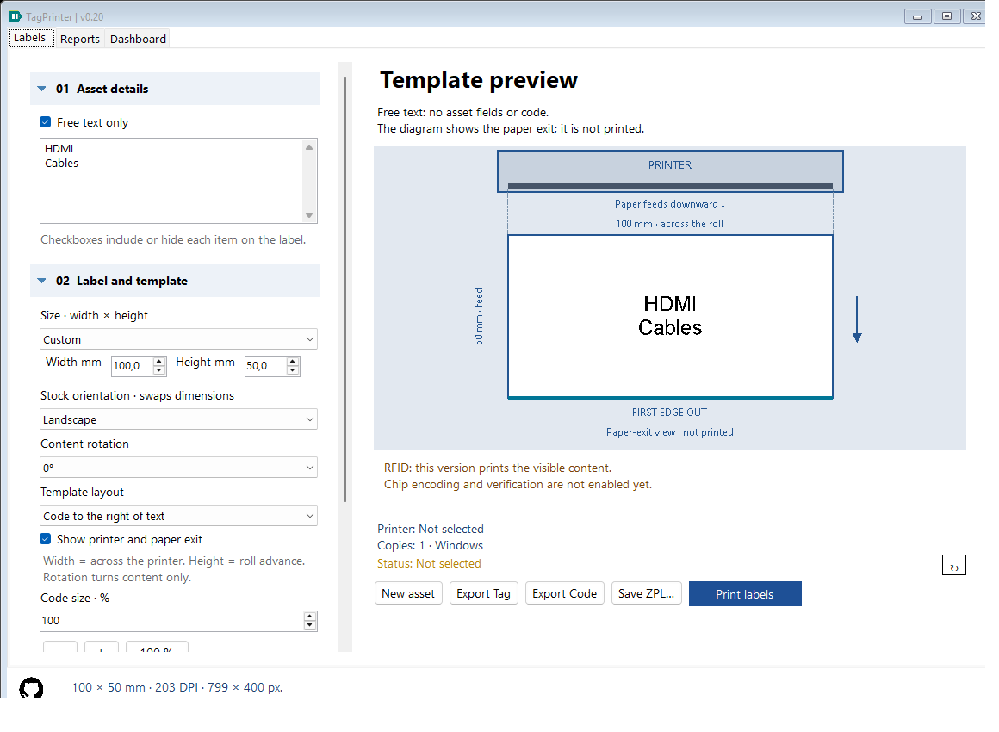
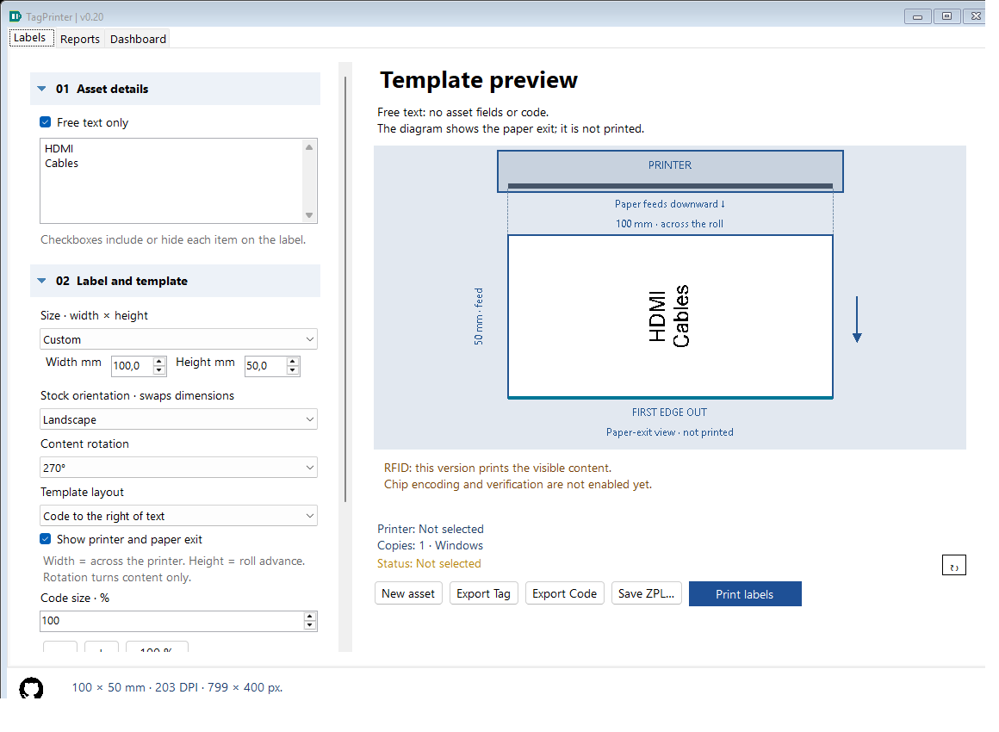
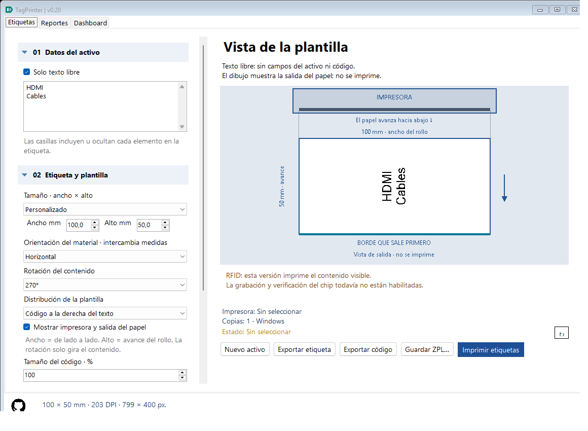

# Printer and paper-exit preview — 0.20

The preview places a fixed printer above the actual label bitmap. Paper always advances downward in this front-view diagram. The bottom edge, furthest from the printer, is highlighted as **FIRST EDGE OUT**. A downward arrow and physical-width/feed-length captions establish the reference independently of text orientation.

## Try it without a printer

1. In 02 Label and template choose 100 mm width by 50 mm height, matching stock that is 100 mm across the printer and 50 mm along roll advance.
2. Keep **Show printer and paper exit** enabled.
3. Enter a recognizable asymmetric sample, such as HDMI and Cables, or use asset text plus QR.
4. Change **Content rotation** through 0°, 90°, 180° and 270°. Text and code turn together; printer, paper dimensions, downward arrow and leading edge stay fixed.
5. Export Tag to inspect the undecorated bitmap. The printer diagram, dimensions, arrow and leading-edge stripe are not printed or exported.

The physical **Stock orientation · swaps dimensions** selector is separate: it really exchanges width/height and selects custom material. Do not use it to turn the text on an unchanged roll. For physical 100 × 50 stock, retain 100 × 50 and change Content rotation.

Disable Show printer and paper exit for a larger plain label preview. That preference survives autosave/restart, history and configuration transfer. The obsolete user-selected Physical paper feed direction selector has been removed. Its saved FeedDirection field is preserved for old file round trips but ignored by the fixed diagram.

## Scope

This is a representation of the bitmap TagPrinter sends, with a fixed front-view convention; it does not detect a physical printer, roll loading, cutter position or driver rotation. Windows media setup/calibration/scaling must still agree with the selected physical stock. The previously reported driver/media-orientation case still needs hardware confirmation. The software does not claim physical output or RFID encoding.

## Implementation

PaperFeedPreview subclasses PictureBox. OnPaint draws a printer, feed path and leading-edge indicator around the same owned Image that MainForm renders for the ordinary preview. PaperBounds uses the rendered physical width/height, never content rotation. MainForm.UpdatePaperPreview supplies stock dimensions and visibility. Preview decorations do not enter LabelRenderer, PNG, raster ZPL or PrintDocument. No image file or printer connection is needed to build the diagram.

PaperFeedTests rotates synthetic 100 × 50 stock at all four quarter turns, compares fixed printer-header pixels and paper bounds, compares the actual undecorated preview bitmap byte-for-byte with Export Tag, checks the removed selector, saves bilingual screenshots and verifies restart compatibility. Existing label/code decode, configuration, history and package checks remain in the suite. Tests submit no printer jobs.
