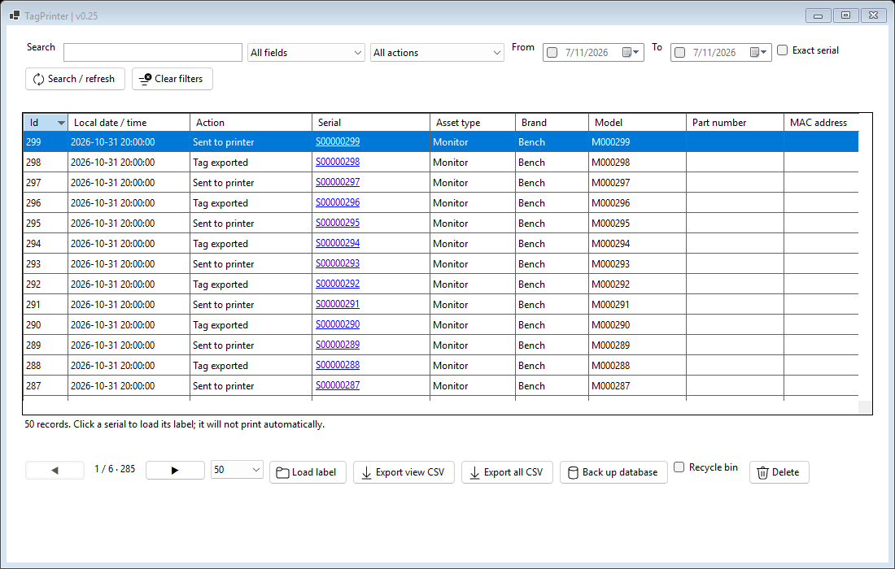
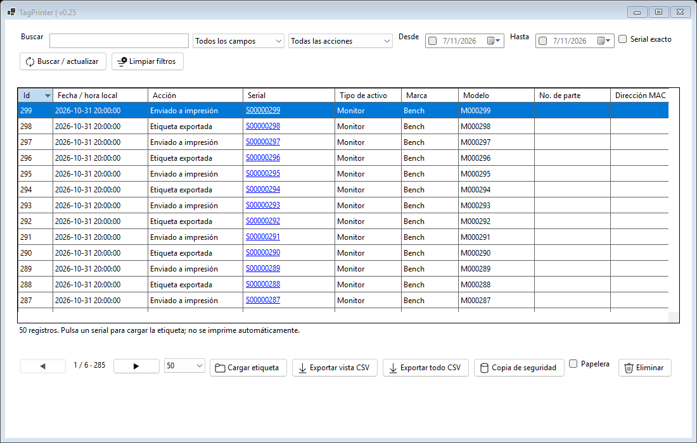
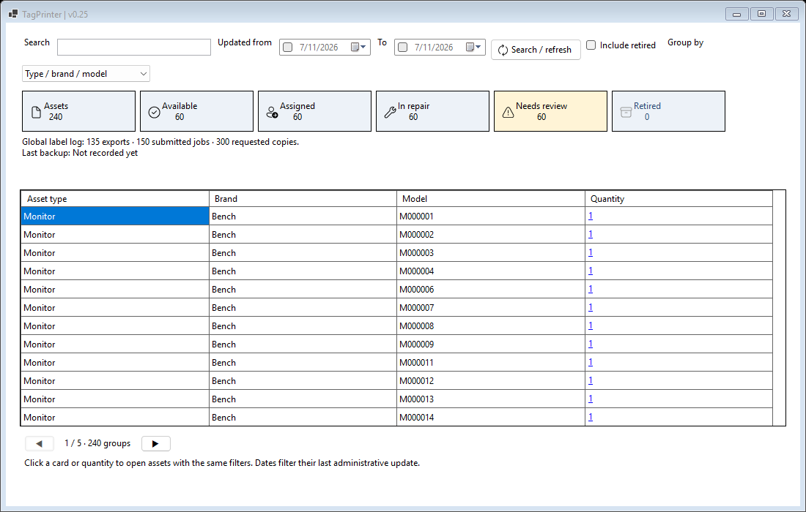

# Large histories and inventories — TagPrinter 0.25

## What changes for the user

- Reports, Assets and Dashboard read on background workers. Each view keeps one worker and replaces obsolete requests; changing filters interrupts old SQL and only the newest result can update the screen. Hidden tabs defer reads until opened. Loading indicators distinguish pending results from completed rows.
- Reports reads only the selected 50/100/250 summary rows. Complete WorkState snapshots are loaded for explicit recovery or bounded page export. ID-based loading/sorting remains intact.
- Assets reads 50 canonical records per page. **Exact serial / Serial exacto** selects an indexed lookup; ordinary literal substring search remains available.
- Reports also offers Exact serial. This mode searches serial regardless of the disabled general-field selector. Asset matching trims and uses invariant Unicode uppercase; historical serial matching retains SQLite ASCII case-insensitive comparison.
- Dashboard shows **50 groups per page**, with previous/next navigation. Cards and global label-log totals still summarize their full scope. Quantities preserve the exact raw group/filter/date values even after sorting within a page.
- Movements reads 50 administrative changes per page, expanding only those before/after snapshots into field differences and reasons.
- Catalog dropdowns/browser show up to 200 options. The catalog browser searches name prefixes; editing a dropdown prefix narrows its next opening. The current input remains available. Label inputs offer a bounded first set and reuse unchanged native autocomplete sources during restoration. All options remain in SQLite and unlisted values can still be typed/saved.
- History/master CSV exports stream rows with progress and cancellation. Export all CSV retains active-versus-recycle scope and ignores ordinary report filters; Export assets CSV includes every matching asset across pages.








## Streaming and cancellation

Full history export selects metadata, scalar design fields and original StateJson directly from one SQLite read snapshot. It does not materialize/deserialise every WorkState. Original JSON is quoted verbatim; loading it still supplies compatible defaults. Master export likewise selects scalar administrative fields without building a whole registry in memory.

CsvFile writes quoted UTF-8/BOM cells one row at a time, preserving leading zeros, semicolons, quotes and newlines. Numeric cells use invariant formatting regardless of Windows culture. A temporary file is created beside the chosen destination. Only a fully flushed successful export replaces the destination. Cancellation/failure before replacement removes the temporary file and preserves an earlier destination. The final replace is the commit boundary; cancellation after it cannot undo a completed export. An abrupt process/OS termination can leave a temporary file, while the previous destination remains protected before replacement.

The progress window stays responsive and keeps cancellation/cleanup alive before closing. SQLite reads use a worker-owned connection, deferred read transaction and native interrupt callback. The callback registration is disposed before the connection handle closes, as required by SQLite's cross-thread interrupt contract. Each view coalesces pending requests rather than creating an unbounded number of workers. A disposed view cannot receive later results.

## Derived indexes and compatibility

Inventory schema remains **3**. Startup installs eleven rebuildable expression/partial/prefix indexes when missing; it does not rewrite event snapshots, master identity, assignments, audit or catalogs. Existing schema-3 files stay compatible with earlier binaries. Schema-1/2 migrations retain their protected safety-copy behavior. Restoring an older snapshot creates the same performance indexes on its staged copy before live replacement.

Indexes cover inventory-event IDs/date/action/trimmed serial, master update order/state/location/custodian/description/active groups, and catalog prefix browsing. Expressions match the query predicates and ordering exactly. For the existing partial unique master-serial index, lookup SQL explicitly includes serial_key!=''; an application-side nonempty check alone does not make SQLite's partial-index proof select that index. The benchmark asserts actual EXPLAIN QUERY PLAN output.

The first open after updating can take longer while indexes are built, especially on large databases or slow disks. SQLite commits that DDL transaction atomically. Once present, startup skips index construction. Indexes increase disk space and write work in exchange for faster reads; database backups include them. PRAGMA quick_check and complete backup validation retain their existing correctness checks.

## Import memory

Administrative import keeps its established 10 MB / 10000-row limit and bounded 200-asset review table. A prepared read context now resolves assets and vocabulary lazily inside a consistent snapshot, rather than loading the entire global catalog or opening a new connection for each lookup. Its cache grows with imported values, not total installed vocabulary. Commit still rechecks asset revisions/catalog spelling and rolls back the entire plan on failure.

## Measured evidence

PerformanceTests builds synthetic files containing **100000 assets, 100000 history events, 100000 movements and 100000 catalog options**. It measures median first-page reads before/after the new indexes, checks planner use, validates totals/filter/order against the original snapshot APIs, and exercises large exports without using real user records or printers.

The active fixture has 95000 visible history rows and 80000 non-retired unique description groups. Only 50 report rows/groups/movements and at most 200 suggestions are returned to a view. Cancellation is tested during actual native SQL and during export, and a failing source must preserve an existing destination. Tests use the actual modal export dialog for success/failure/cancel and real WinForms controls with cross-thread access checks enabled.

Managed-memory evidence samples live managed objects after forced collections at export checkpoints. It excludes native SQLite caches, transient allocations, OS file cache and total process working set; it is not a claim about total RAM. Timings depend on hardware, disk, concurrent load and cache state. Assertions check correctness/bounds/planner use, not a brittle maximum latency. Full source and published suites remain required.

Published Windows x64 verification, 2026-11-07 (synthetic data):

| Measurement | Observed |
|---|---|
| Assets / history / movements / catalog options | 100,000 each |
| Median default asset page before derived indexes | 445.397 ms |
| Median default asset page after derived indexes | 2.754 ms |
| Full-scope Dashboard computation / groups materialized | 1,382 ms / 50 of 80,000 |
| CSV rows / bytes / elapsed | 95,000 / 92,104,632 / 1,924 ms |
| Additional sampled live managed bytes during export | 349,408 |


## Running the checks

```powershell
./scripts/Test.ps1
# Focused iteration after a Release build:
dotnet src/TagPrinter/bin/Release/net8.0-windows/TagPrinter.dll --self-test --performance-only
./scripts/Publish.ps1
```

Results are written under the executable's isolated verification directory as performance-results.txt and performance-measurements.json. Synthetic databases/CSV/status files are excluded from the distributed ZIP.

## Practical limits

Arbitrary **contains** searches may scan matching data; indexes do not turn every substring into a fast seek. Use Exact serial for known identifiers and date/state/location filters for narrower views. Deep OFFSET pages still require walking preceding index entries. Dashboard still aggregates its full filtered scope to compute correct counts, while only a page reaches the UI. Long WAL readers can retain WAL pages until their snapshot closes. Initial integrity/index work, full restore validation and bounded import commits can still take time. Millions of records and slow/network/cloud-backed disks require separate measurements; this release verifies the stated synthetic scale rather than a universal capacity guarantee.

The application remains local and has no login/roles module. Synchronization and physical printer/RFID validation remain separate pending work.

## Primary technical references

- [SQLite indexes on expressions](https://www.sqlite.org/expridx.html): expression matching for WHERE/ORDER BY.
- [SQLite partial indexes](https://www.sqlite.org/partialindex.html): predicate implication and index eligibility.
- [Microsoft.Data.Sqlite async limitations](https://learn.microsoft.com/en-us/dotnet/standard/data/sqlite/async): SQLite ADO.NET async methods execute synchronously; work belongs outside the UI thread.
- [Deferred SQLite transactions](https://learn.microsoft.com/en-us/dotnet/standard/data/sqlite/transactions): consistent read scope.
- [SQLite interrupt contract](https://sqlite.org/c3ref/interrupt.html): cross-thread interruption and handle lifetime.
