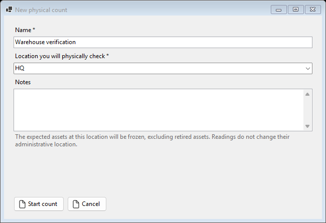
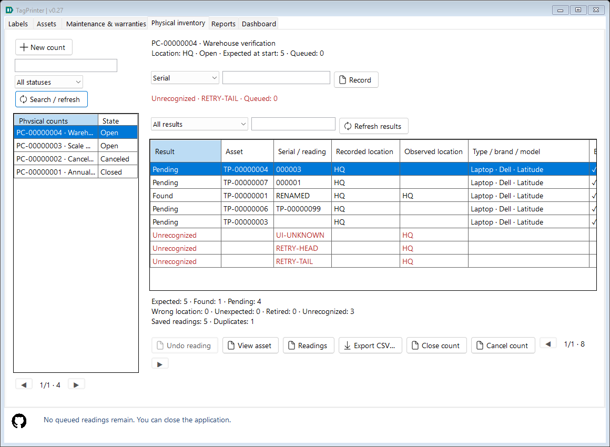
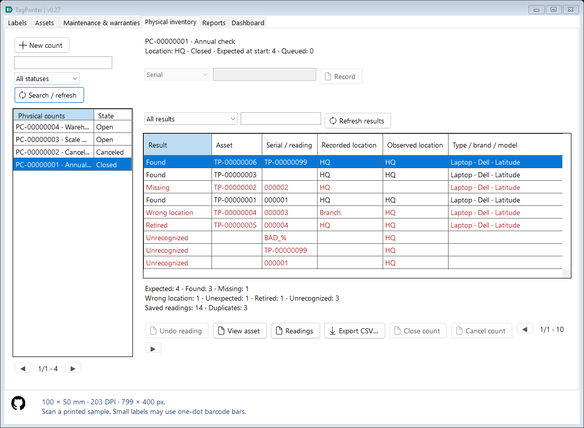
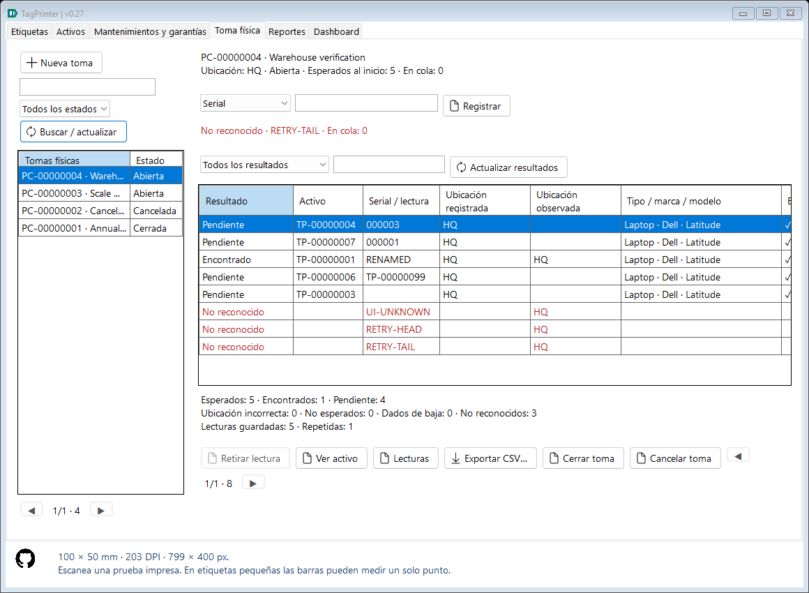
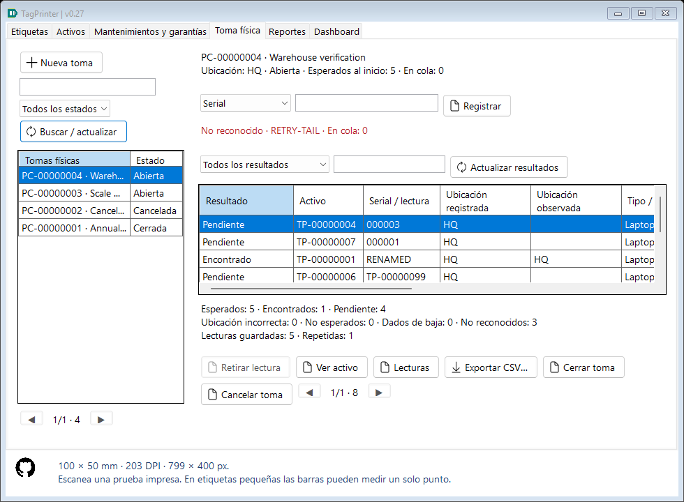
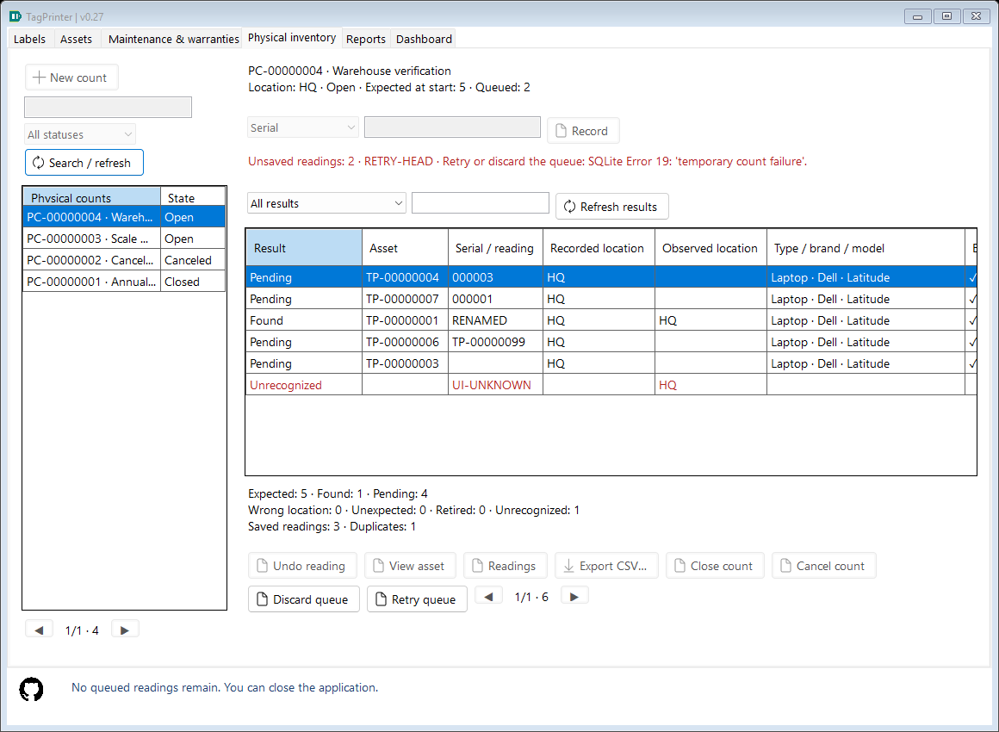

# Physical inventory — TagPrinter 0.27

## Start a location walk

Open **Physical inventory / Toma física** and choose **New count / Nueva toma**. Enter a name, the exact location you will physically check and optional notes. Existing catalog location spelling is reused after trim/invariant case normalization. The editable location dropdown reads up to 200 prefix suggestions; a new location can also be typed.

Starting commits one frozen list of all non-retired assets registered at that location. A location with no expected assets is allowed, so unexpected equipment can still be recorded. Each session has a PC reference and a persistent Open/Closed/Canceled state. It does not require a printer, application accounts, network access or RFID. It creates neither assets nor label-output events.

## Scanner or manual input

Use a scanner in **keyboard-wedge/HID keyboard mode**, configured to finish each reading with **Enter**. Focus the reading box. Manual typing/pasting followed by Enter or Record follows the same path. This release does not decode a camera feed or image file.

The default **Serial** mode matches the complete serial, including leading zeros. Existing TagPrinter QR/Code 128 labels encode that serial. Edge spaces are trimmed and the same invariant uppercase lookup normalization as canonical inventory is used. It does not search by partial text or strip punctuation. Blank/control-bearing payloads and identifiers over 120 characters are rejected; the input box permits longer input so an oversized scan cannot silently truncate into a valid shorter serial.

Choose **Asset code** explicitly for TP-00000001-style identifiers, including assets with no serial. Modes are deliberately separate: a real serial that looks like a TP code is still a serial in Serial mode. Asset code accepts the exact canonical TP numeric format. This does not change what existing label QR/barcodes encode.

## What results mean

| Result | Meaning |
|---|---|
| Pending | Expected at the start, without an effective reading. It is not yet declared missing. |
| Found | An expected asset has been read. |
| Missing | An expected asset remains unread when the session is explicitly Closed. |
| Wrong location | A recognized, non-expected asset was observed here, while its captured inventory location is different. |
| Unexpected | A recognized, non-expected active asset has this captured location, for example an asset registered after the baseline was frozen. |
| Retired | A non-expected recognized asset was already retired in its captured record. |
| Unrecognized | Input could not be linked safely to a unique asset. It remains evidence, never a fabricated inventory master. |
| Withdrawn | A non-expected reading was explicitly undone; available through this filter and the action history. |

**Found + Pending/Missing = Expected.** Wrong-location, unexpected, retired and unrecognized entries are separate; they do not inflate the expected-found count. Repeated readings produce Duplicate feedback/audit but do not add another asset or replace the first effective reading time.

Expected snapshots retain asset UID, internal code, serial, description, location, state and source timestamps at session creation. Other recognized assets retain their first-capture snapshot. Later master edits do not rewrite those snapshots, even after Undo/rescan. Actual observed location is the session location for every effective reading. A retired-after-start expected asset remains in the original baseline.

Serial edits resolve through the stable current asset UID as well as captured serials. If a captured serial and a current/reused serial point to different assets, or multiple frozen assets share the identifier after explicit code readings, Serial mode refuses to choose silently. It records an unresolved attempt and asks for **Asset code**. Read the intended asset code, then withdraw the unresolved reading if it should no longer appear in active results. A later registered/edited master does not automatically rewrite earlier unresolved evidence.

## Review and finish

Sessions are searchable by name, code, location or notes, with state filtering and 25 sessions per page. Select one to resume an Open walk. Results have literal search, outcome filters and 50-row pages. Totals cover the entire session independently of search/outcome/page. Recorded and observed location columns wrap their headers and remain separate. Secondary evidence is reachable by horizontal scrolling.

**Undo reading / Retirar lectura** requires confirmation and an Open session. It makes an expected asset Pending again, or withdraws a non-expected observation. It never deletes the original action. The same item can then be read again. **Readings / Lecturas** shows 50 audit actions per page: creation, saved input, duplicates, withdrawal and closure/cancellation.

**View asset** opens the exact current canonical asset for review. Updating location/custody/state is a separate explicit Assets operation with its existing audit; counting never silently moves or retires equipment. Historical count evidence keeps the original baseline/capture after such edits. Start a new session when a new baseline is needed.

**Close count** confirms that unread expected assets become Missing. Closed sessions are immutable; they cannot accept scans, Undo or reopening. **Cancel count** retains readings but leaves unread assets Pending rather than asserting they are missing. Canceled sessions are also read-only. There is no hard-delete command for sessions/evidence in this release.

## Durable queue and saving

Each accepted input is queued in a FIFO of at most **100 unsaved readings**. One worker saves them in order. Input remains usable while a healthy queue drains; each success is acknowledged only after the effective record, session revision and audit commit together. Full queues reject another submission without clearing its input. Queued is not the same as saved.

If SQLite/disk writing fails, the failed head and remaining inputs stay in memory, scanning pauses, and Retry queue/Discard queue become visible. Retry continues the retained order. Discard requires explicit confirmation and drops only unsaved queued input; already committed observations/actions remain. Changing sessions, finishing, Undo and exports are disabled while writes/input remain pending.

Normal application closure is blocked while readings or writes are pending, with instructions to wait or resolve a paused queue. Once resolved, closure can be retried. A process crash, power loss or forced termination can lose uncommitted in-memory input. Committed readings survive restart in the Open session and repeated readings remain safe. This is not an always-running background scanner/service.

## CSV reports and full backup

Export CSV streams **every filtered result page**, with session context and frozen asset evidence. It uses UTF-8/BOM, semicolons, quoted cells and stable English outcome/status/mode keys, preserving original serial zeros and entered notes. Fields: SessionCode, SessionName, SessionStatus, ObservedLocation, SessionCreatedUtc, SessionClosedUtc, AssetUid, AssetCode, Serial, AssetType, Brand, Model, RecordedLocation, Expected, Observed, Outcome, ObservedUtc, InputMode, InputValue, RecordedAssetStatus, RecordedCustodian, SessionNotes, AssetSnapshotUpdatedUtc.

Readings offers a separate full action CSV, including duplicate and withdrawn attempts, captured identity-resolution JSON, revisions and UTC times. The ordinary result export is a report rather than an import/complete recovery format. Both use progress/cancel and same-directory staging; cancellation/failure before replacement preserves a previous destination.

Existing automatic/manual SQLite backups cover sessions, expected snapshots, observations and complete action history alongside assets, services and label history. A backup contains commits visible at its snapshot time, not unsaved queued input. Database restore is blocked in this instance while count writes/input are pending. Configuration/profile JSON and exported files are separate.

## Schema 5, compatibility and recovery

Schema **5** adds count_sessions, count_entries and count_actions, foreign keys, stable per-asset/per-unknown uniqueness, frozen-serial/page/effective-action/summary indexes and session revisions. Existing schemas 1–4 are supported. Before upgrading schema 4, startup creates **backups/TagPrinter-before-counts-...db**. Earlier schemas retain their before-assets/before-catalogs/before-services safety prefixes. Migration creates the new tables transactionally and does not rewrite original asset/service/label snapshots. It runs once, not on every startup.

Restore validates a staged copy, upgrades it to 5, validates again, preserves a full current safety backup and then replaces live pages through SQLite. Validation checks expected-scope counts, frozen asset metadata, duplicate-safe entry identity, session revision/lifecycle chains, raw-input identity resolution, action-to-entry session links, effective observation fields and prior Seen/Undo state, plus declared/actual foreign keys. Broken count evidence must not replace live data. Old backups without counts intentionally restore an earlier state with no sessions.

Older executables reject schema 5. For rollback preserve current data and use a matching protected prior-version copy, which excludes later changes. Close other TagPrinter instances during upgrade/restore. The module has no users/permissions or multi-device synchronization; local SQLite revisions also reject stale explicit close/Undo commands from another window.

## Student source walkthrough and verification

- CountModels defines immutable query/result records; a CountSession holds lifecycle/scope, while CountEntry keeps frozen evidence and effective observation fields.
- CountStore.Create uses one SQL INSERT SELECT inside a write transaction, avoiding a whole-registry managed list. Scan resolves explicit identity, prevents ambiguous reassignment, and commits observation/session revision/action atomically. Duplicate does not overwrite an effective reading. Undo and Finish enforce Open state and optimistic revision.
- CountStore.Queries uses parameterized literal search, cancellable consistent read snapshots, bounded pages and streaming CSV. Outcome SQL mirrors the C# classifier. Counts never infer physical observations from print events.
- CountStore.Validation walks ordered action revisions with bounded retained state, then uses indexed effective-action lookups to validate replay/final fields. A partial Seen/Undo index avoids duplicate-heavy quadratic validation.
- PhysicalCountsView captures input on the UI thread and drains one bounded FIFO worker. BackgroundRead coalesces list updates, generation/revision guards prevent stale display, and failed writes retain the queue head. MainForm.Counts guards normal closure; NewCountDialog inserts scope off-thread.
- CountTests uses isolated real SQLite and WinForms. It covers classification, frozen edits, reused serial ambiguity, duplicates, withdrawal/terminal states, stale guards, 10000 assets, actual index plans, action failure rollback, malformed backups, schema-4 migration/legacy restore, CSV, oversized scanner input, actual queue failure/retry/order/close guard, asynchronous controls and bilingual/minimum-size captures.

No RFID encoding/reading or printer logic was changed. Automated tests use typed/simulated keyboard input, not a physical scanner; scanner suffix/keyboard-layout and real device behavior remain user-hardware checks. Cross-location multi-device collection, attachments, automatic master corrections and count-session editing/reopening are outside this version.
