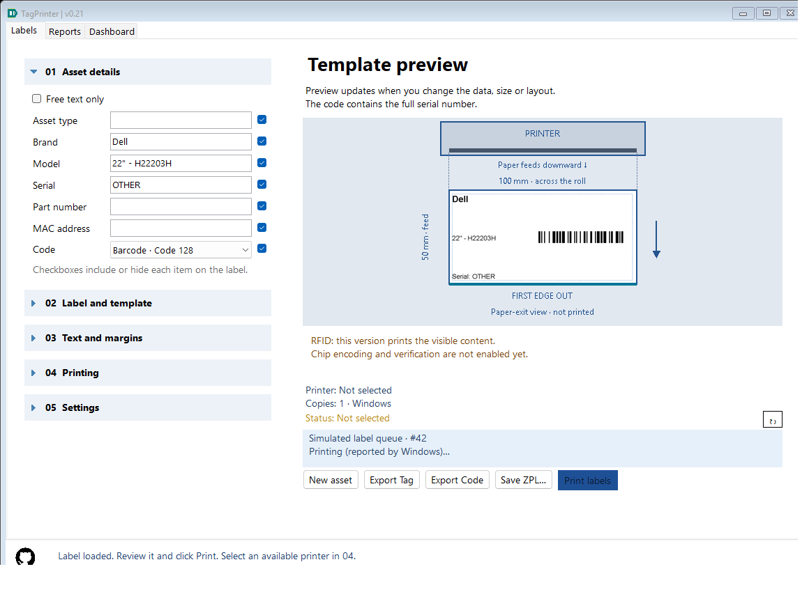
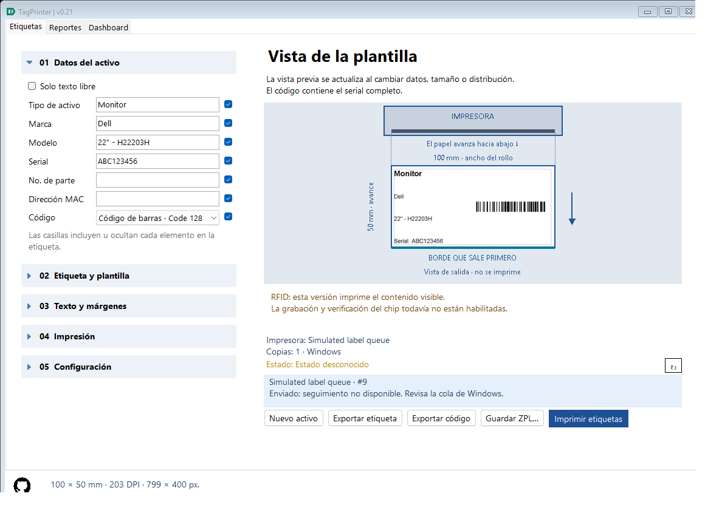

# Inventory-only history and print-job progress — 0.21

## Free text is not inventory

When **Free text only** is enabled, Print labels, Export Tag (PNG), Save ZPL and Export Code do not insert any inventory event. Last-work autosave and full configuration export/import still retain the free-text draft and its formatting. Ordinary asset-field labels with the Code checkbox disabled remain inventory; they are different from Free text mode.

Previously stored rows whose snapshot explicitly has FreeTextMode=true are hidden from Reports, CSV built from Reports and Dashboard. They are preserved in the database/backup, not silently erased. A database backup can therefore still contain these older rows. Rows not marked FreeTextMode cannot safely be inferred to be free text.

## Ctrl + P

On **Labels**, Ctrl + P runs the same command as Print labels for the current editor contents, selected printer, method and copies. Invalid labels and missing printers are rejected before submission. Repeated presses do not create another job while the current submission/tracking is active. On Reports/Dashboard the shortcut directs the user to Labels instead of printing a hidden draft.

The work and loaded-source ID are captured before asynchronous submission. Later edits, changing tabs or loading a different history record cannot change the submitted bitmap or its recorded inventory provenance. No print job is created by recovering a history record alone.

## Temporary job notice

A notice above the output buttons shows the captured printer and, when available, Windows job ID. It expands only while present, then returns its space to the preview.

- Sending to Windows: submission is running off the UI thread.
- Submitted / looking in queue: Windows accepted the submission; waiting for an observation.
- Spooling, queued, printing, paused, offline, out of paper or error: the observed job status from Windows.
- Windows reports sent/completed: Windows flags reported completion, not physical/RFID confirmation.
- Windows is removing the job: wait for deletion or disappearance; this is not treated as completed output.
- Job left the queue: a previously observed job disappeared; output could have completed or been removed/canceled.
- Job not observed: three initial reads found no matching job, possibly because it left too quickly. This is not reported as printed.
- Tracking unavailable: permissions, Windows/API failure, a changed document title or a read timeout prevented reliable observation.
- Tracking ended: after two minutes, follow the work in the Windows queue; the app does not cancel it.

Terminal notices disappear after eight seconds. Errors/waiting states are polled while the job remains visible, up to the tracking limit. Submission failure warns to check the queue before retrying, because a partial submission may exist. There is no automatic retry or cancellation. Closing TagPrinter stops its monitoring; an already submitted Windows job is not canceled. Keep the app open until the submission returns if you need its inventory action recorded.

Submission may itself block inside a driver; the interface remains responsive and the notice continues to say Sending until Windows returns. The app does not invent a completion time or percentage. Per-job reads have a five-second UI timeout and one bounded native query worker across monitors, so a hung read does not create unlimited workers. Polling uses roughly 1.5 seconds between observations and may miss brief transitions.

## Driver and direct ZPL

Each submission has a unique TagPrinter document title. Windows-driver work is found by that exact title on the captured printer; numeric ID is displayed once observed. Direct RAW ZPL retains StartDocPrinter's returned ID and matches both title and ID. Other applications' jobs and reused IDs with another title do not satisfy the correlation.

This is informational spooler monitoring. It does not query the printer's RFID memory, paper path or label sensor and never cancels or edits foreign jobs. Physical output, driver calibration and real queue behavior still require a hardware trial.

## Implementation and validation

MainForm.Printing owns the shared command, immutable snapshot, asynchronous submission, busy gate, transient banner and lifetime cancellation. RawPrinter.Send returns the real spooler ID and verifies RAW page/document completion calls. WindowsPrintJobs reads bounded JOB_INFO_1 buffers off-thread. PrintJobTracker interprets status without UI or native dependencies. HistoryStore.Add rejects FreeTextMode snapshots; report Query filters marked legacy rows without deleting them.

PrintingTests injects submission/observation tasks and uses real isolated JSON/SQLite/forms. It counts physical database rows for all free-text output types, checks old rows remain on disk but invisible to reports, key-repeat suppression, exact captured state/provenance, progress/timeout/notice expiry and disposal. The test suite does not send jobs or query physical printers.

Native contracts: [JOB_INFO_1](https://learn.microsoft.com/en-us/windows/win32/printdocs/job-info-1), [EnumJobs](https://learn.microsoft.com/en-us/windows/win32/printdocs/enumjobs), [StartDocPrinter](https://learn.microsoft.com/en-us/windows/win32/printdocs/startdocprinter). Windows completion can precede physical output when a port monitor lacks true end-of-job support.
