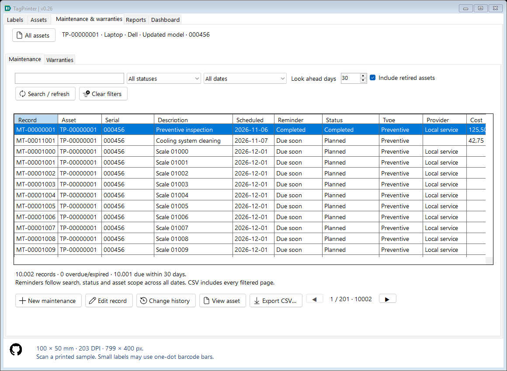
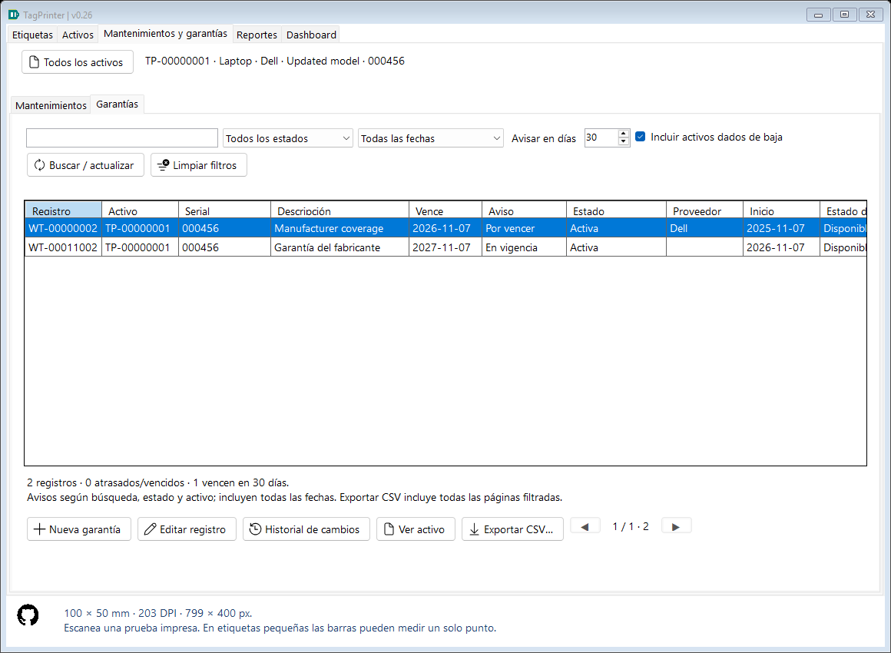
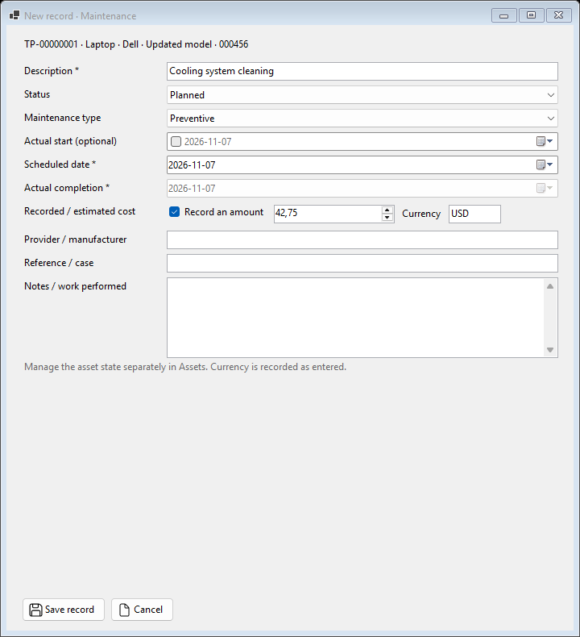
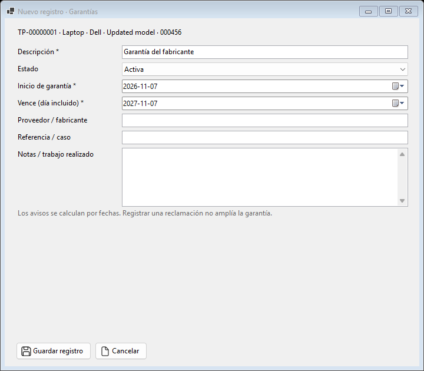
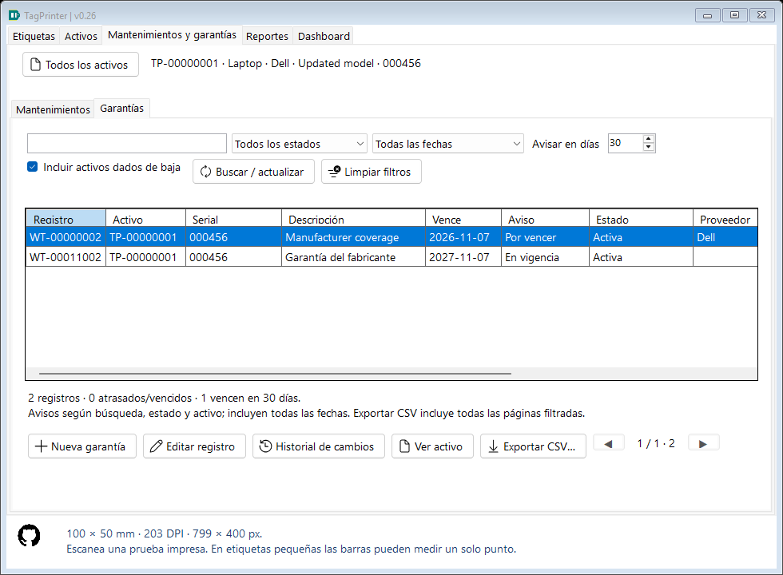

# Maintenance and warranties — TagPrinter 0.26

## Purpose and entry points

This local module tracks work and warranty dates for existing canonical assets. It needs neither a printer nor application accounts. Open **Maintenance & warranties**, or select an asset in **Assets** and choose **Maintenance / warranties**. Two subtabs keep jobs and warranties separate.

From the global module, New maintenance/New warranty opens a searchable, 50-row asset picker. Register the asset in Assets first if it does not exist. Creating a service record never creates an asset, a label-history event or a print job. The per-asset route preselects the immutable asset GUID. All assets clears that scope. View asset opens exactly that asset, including one without a serial.

Serial, model and other descriptive edits do not detach service records: list/CSV captions read the current asset through its stable identity. Creating a record globally switches to that asset so the saved record is easy to find.

## Maintenance fields and workflow

| Field | Meaning |
|---|---|
| Description | Required, at most 160 characters. |
| Type | Preventive or Corrective. |
| Status | Planned, In progress, Completed or Canceled. |
| Scheduled date | Required calendar date used for deadline reminders. |
| Actual start | Optional actual start date. |
| Actual completion | Required for Completed; stored only for that state. It cannot precede an entered start date. |
| Recorded / estimated cost | Optional nonnegative decimal with at most two places, up to 999999999.99. Blank and zero have different meanings. |
| Currency | Exactly three ASCII letters when an amount is supplied, normalized to uppercase; for example USD or COP. No exchange-rate conversion, currency validation service or mixed-currency total is performed. |
| Provider / manufacturer | Optional, at most 160 characters. |
| Reference / case | Invoice, service order or case, at most 120 characters. |
| Notes / work performed | Optional work, result or cancellation reason, at most 4000 characters. |

Choose Edit record to move between states or correct entered information. Changing a service does not automatically set the asset to Repair, return it, assign it or retire it. Use the existing Assets workflows for physical custody/state. This avoids inventing administrative movements from a planned job.

## Warranty fields and workflow

A warranty contains description, provider/manufacturer, reference/case, notes, required start/expiration dates and one of **Active**, **Claim open**, **Closed**. Start cannot follow expiration. Multiple warranties may describe one asset; their coverage is not merged automatically.

Opening a claim records a state/revision and may include a case reference and notes. It does not extend expiration. Closed records remain searchable; reopening/correcting a record creates another revision. No business record is hard-deleted from this module. Warranty cost/purchase accounting, attachments and claim-document management are outside this version.

## Local reminders and date rules

Dates are stored as ISO `yyyy-MM-dd`, separate from UTC creation/update timestamps. Date controls show that format explicitly and accept years 1900–9998. Reminders use the current Windows local calendar date when a list opens or refreshes, and when CSV export begins. They do not run while TagPrinter is closed and do not send messages, email, tray notifications or server requests.

- Planned/In progress maintenance is overdue when scheduled before today; Completed/Canceled is excluded.
- An Active/Claim open warranty is expired after its expiration day. The expiration day itself is included. Closed is excluded. A future start is displayed as Not started.
- Look ahead defaults to 30 days and can be changed to 1–365. Upcoming deadlines includes today and the final look-ahead day.
- Needs attention includes open records with deadlines through the look-ahead date, including earlier overdue/expired records.
- Reminder totals follow search, status, asset and retirement scope, but deliberately ignore the deadline selector. They label their scope and are not limited to the current page.
- Retired assets are excluded from global lists initially. Include retired assets shows their preserved records. A per-asset view includes retired assets automatically.

Active is an entered workflow state; it is not silently changed to Closed/Expired by the calendar. The Reminder column reports the separate date calculation. Descriptions/notes and dates are manually recorded information, not proof that work occurred or that a manufacturer accepted coverage.

## Search, paging, export and changes

Search matches literal fragments of current asset code/serial/type/brand/model and service description/provider/reference/notes. Percent/underscore input is literal, not SQL syntax. State and deadline selectors narrow the list. Enter or Search / refresh applies text changes; Clear filters keeps an explicit asset scope, while All assets removes it.

Lists read 50 records per page on a coalesced, cancellable background worker. Column clicks on record, asset, serial, description, scheduled/expiration date, status or provider apply a whitelisted global sort. Other columns are informational. Secondary columns are available by horizontal scrolling. Each list retains only its page; obsolete reads cannot overwrite new filters.

Change history displays field-by-field before/after values with local time and revision number, reading 50 immutable revisions per page. Each successful changed save and its audit row commit in one transaction. A stale editor is rejected, an unchanged save creates no revision, and failed writes roll back both record and audit. There is no application login or account/permission administration.

Export CSV streams **all filtered pages** through the existing progress/cancel dialog and atomic destination staging. It uses UTF-8/BOM, semicolons, quoted fields, invariant decimal points and ISO dates. Leading-zero serials remain intact in the file. Columns: Id, Code, AssetUid, AssetCode, AssetType, Brand, Model, Serial, Kind, Title, Category, Status, StartDate, DueDate, CompletedDate, Provider, Reference, Cost, Currency, Notes, CreatedUtc, UpdatedUtc, Revision. Codes/kinds/statuses/categories are stable English keys, independent of UI language. Warranties leave maintenance-only cells empty. This CSV is a report, not a full database/audit backup or an implemented service-import format.

## Persistence, upgrade and recovery

SQLite schema **4** adds asset_services and service_changes, foreign keys, due-date/state/asset indexes and append-only revision snapshots. Existing schema-1/2/3 databases are supported. Startup preserves a protected copy before migration: before-assets for 1, before-catalogs for 2 and **TagPrinter-before-services-...db** for 3. New tables are created transactionally without rewriting original asset/label snapshots. Later openings do not repeat this safety copy. If the copy/migration fails, preserve the error and affected files; the app does not silently replace inventory.

Manual and automatic SQLite backups cover jobs, warranties, changes and all existing inventory data together. Restore accepts schemas 1–4, validates a staged copy, upgrades it, validates again, preserves a current safety backup and then replaces live pages through SQLite. Validation checks business fields, duplicated metadata, revision continuity, final snapshot equality and declared/actual foreign keys. Invalid service records or audit chains must not replace live data. Restoring an old backup without service tables intentionally returns to the earlier state with no service records; the confirmation covers this full replacement.

Older binaries reject schema 4. To roll back, first preserve current data, then use the protected copy appropriate to the older executable; that older copy excludes later changes. Close other TagPrinter instances during upgrade/restore. Configuration JSON carries design/application settings, not service business records. Exported images/CSV and local backup-status metadata remain separate from SQLite restoration.

## Student source walkthrough

1. ServiceRecord defines persisted data and explicit nullable cost. ServiceFilter/ServicePage carry immutable query input/output between UI and worker.
2. ServiceStore initializes schema, validates data and saves a current revision plus its before/after change atomically. Asset identity and record kind cannot be reassigned after creation.
3. ServiceStore.Queries binds user values as parameters, whitelists sort fragments and uses DatabaseRead for consistent, interruptible count/page reads. CSV enumerates rows instead of retaining the registry.
4. ServiceStore.Validation verifies staged backups with a streaming revision chain: only the previous revision/current master need to be retained while walking the ordered audit.
5. ServiceEditor captures controls only on the UI thread and keeps validation errors/input together. Date-only strings and decimal amounts are distinct from local display formatting.
6. ServicesView/ServiceListView coordinate global/per-asset scopes and lightweight pages. AssetPicker is read-only; ServiceChangesView expands just one audit page. MainForm.Services integrates navigation without touching printing.
7. ServiceTests exercises real SQLite transactions/rollback, 10000-row pages/query plans, date boundaries, stale edits, backup corruption/migration, CSV and actual bilingual UI controls with async reads. Tests use isolated paths and never submit printer jobs.

## Possible later additions

Recurring job generation, attachments/photos, explicit warranty claims with documents, purchasing/accounting, automatic notifications and cost dashboards can be scoped later. Multi-device synchronization and application users remain deferred.
