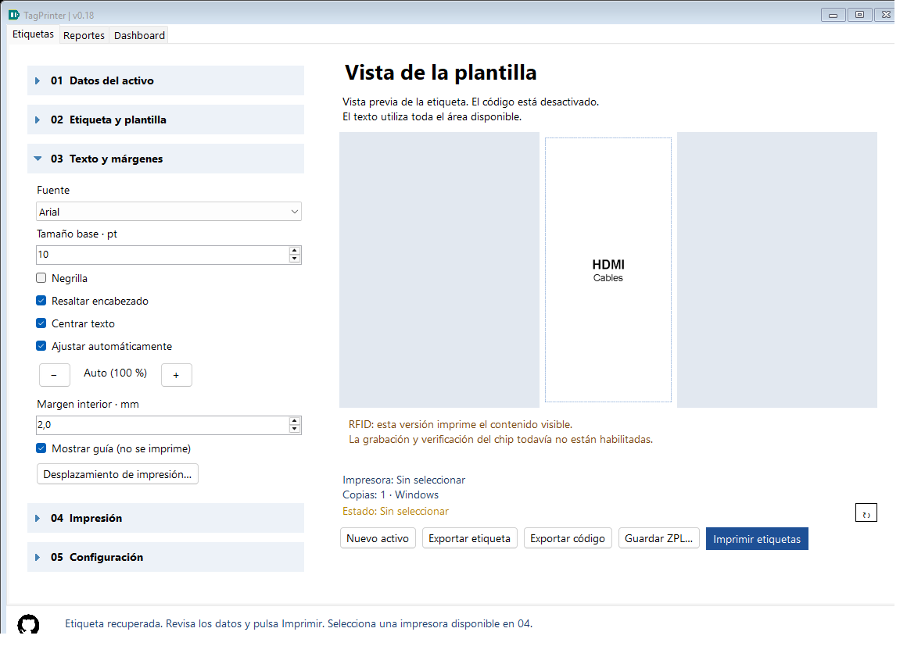
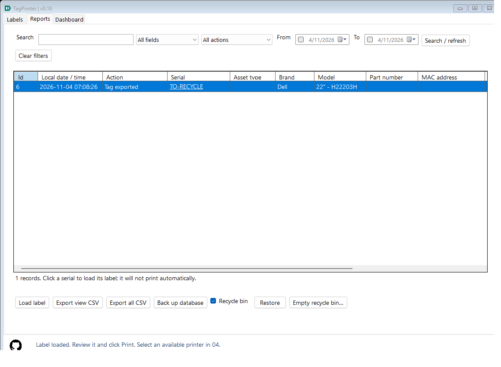
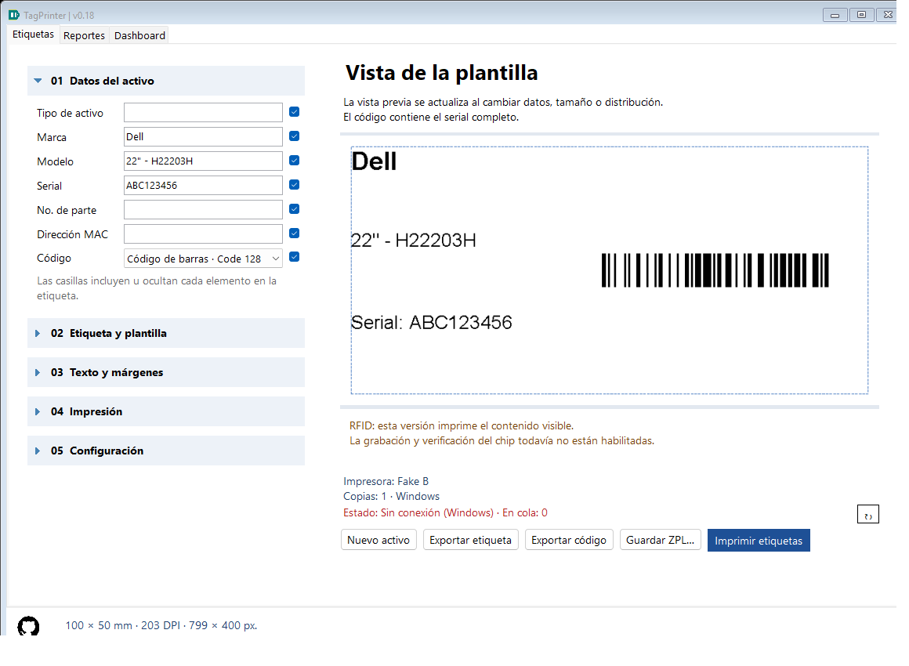

# Centered text, empty recycle bin and Windows printer status — 0.18

## Center text

Expand **03 Text and margins** and select **Center text**. The application measures all visible lines as one block, centers each line horizontally, and places the complete block vertically in the available text area with a small gap between lines. With the code disabled this is the whole margin/offset-adjusted content area. With a QR/barcode present, it is the reserved text area; centering never overlays the symbol.

Font family, heading emphasis, point size, automatic/manual fitting, margins and rotation still apply. If text does not fit, the normal preview error prevents clipped output. Centering is used by preview, full PNG, raster ZPL and Windows-driver output, and survives last-work/history/configuration transfer. Export Code contains no text and is unaffected. Missing CenterText in older snapshots/defaults means false, retaining previous equal-height row placement.

## Empty recycle bin

Open Reports and check **Recycle bin**. **Empty recycle bin…** is visible only there and enabled when the entire bin contains rows. It permanently deletes every recycled event, including those hidden by search, date, action or group filters. The warning gives the total and defaults to No. This action cannot be undone through the application. A separate earlier database backup may still contain those events.

Active events remain. If an active event references a purged source, that provenance field becomes empty so SQLite foreign keys remain valid. The currently loaded label's source reference is also cleared if its event was purged; its editor data remains available for a new output. Event identifiers are not reused. Exported PNG/ZPL files and Windows print jobs are never deleted by emptying the bin.

The model snapshots IDs and clears links/markers/deletes rows in one SQLite transaction with foreign keys enabled. This is logical deletion of database rows, not secure erasure or automatic file-size compaction. Tests use a separate database; they do not empty the user's bin.

## Printer status reported by Windows

A status line and refresh button appear below the printer/copies summary and remain visible when section 04 is collapsed. It refreshes when a destination changes, on request and every 15 seconds while the form is open.

The application reads OpenPrinter/GetPrinter level 2, interpreting Windows queue status/attributes and queued job count. Examples: Ready (Windows), Offline (Windows), Paused, Printing, Busy/waiting, Power saving, Out of paper, Paper jam, Cover open, Error/needs attention, Virtual printer and Status unknown. A missing selection displays Not selected.

**This does not prove the printer is physically on or off.** Windows may cache a remote queue, a driver may omit state flags, and a reachable queue is not a power sensor. Ready means Windows reported no error, not that hardware output was verified. Offline can mean disconnection, a manual offline setting or another availability problem. Unknown includes access/query/timeout errors. Virtual PDF/file queues have no physical power state. Hover over the status for the checked time and available diagnostic details.

Queries run on a worker to keep the UI responsive. After five seconds a pending request displays Unknown; a blocked native call cannot be forcibly canceled safely, so no extra workers are spawned until it completes. A late result is ignored for a different selected printer or disposed form. An eventual result for the current destination can update the display. Native buffers/handles are always released. Polling only reads queues and does not modify drivers, jobs or saved settings.

Status is informational: it does not automatically cancel a print or prevent Windows from queuing an offline job. It is transient and not exported as configuration/history. Tests inject simulated observations, slow queries and selection changes without requiring a physical printer.

Microsoft references: [PRINTER_INFO_2](https://learn.microsoft.com/en-us/windows/win32/printdocs/printer-info-2), [GetPrinter blocking behavior](https://learn.microsoft.com/en-us/windows/win32/printdocs/getprinter), [OpenPrinter cached remote observations](https://learn.microsoft.com/en-us/windows/win32/printdocs/openprinter).

## Source walkthrough

- LabelRenderer uses StringFormat.Center and measured line heights; its legacy path retains existing placement when CenterText is false.
- HistoryStore.EmptyRecycleBin snapshots IDs into a connection-local temporary table, nulls source links and removes markers/events atomically. ReportsView owns confirmation and notifies MainForm about a deleted loaded source.
- WindowsPrinterStatus owns P/Invoke layout, native lifetimes and pure flag interpretation. MainForm.PrinterStatus owns asynchronous polling, timeout presentation, selection/disposal guards and localized captions. No new third-party dependency is required.
- UsabilityTests measures actual output pixel bounds, decodes symbols, checks persistence/transfer, validates purge parent/child behavior and simulates Windows status UI. Hardware power detection and real printer testing remain driver/hardware-dependent.
