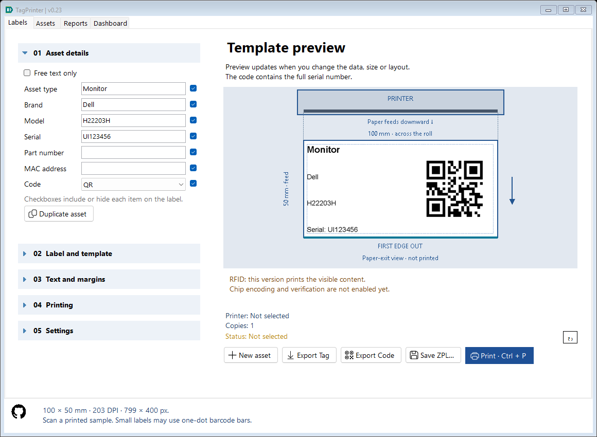
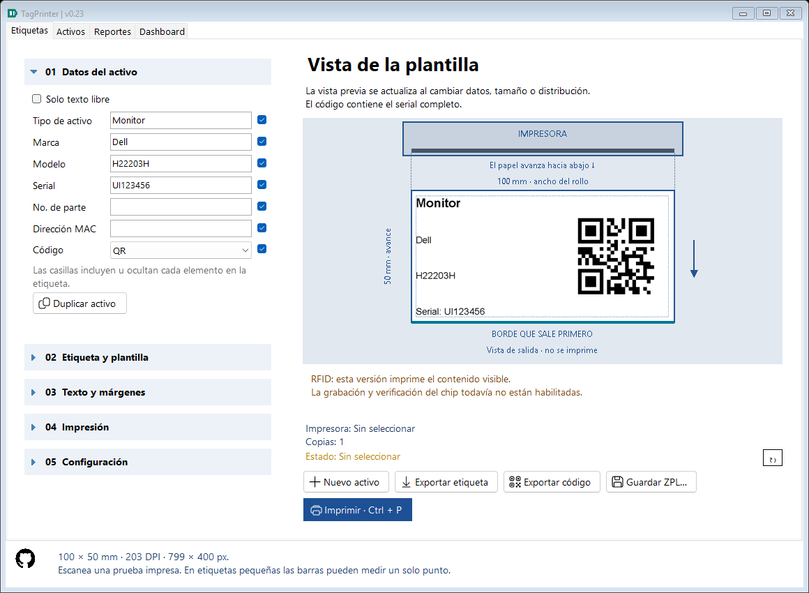

# Clearer actions and Fluent icons — 0.23

The main print action visibly reads **Print · Ctrl + P** or **Imprimir · Ctrl + P**. The existing shortcut, validation and repeat-key protection are unchanged. Printer/copy/status summaries no longer repeat the word Windows. The advanced method is labeled Printer driver / Direct ZPL in 04 Printing; a selected nondefault ZPL method remains identifiable in the summary. Detailed queue-origin/physical-output limits remain in tooltips and the print-progress manual.

Action buttons combine Microsoft Fluent icons with translated text. Compact navigation arrows and the GitHub artwork remain separate; collapsible section headers keep their expansion triangles. Disabled states use muted icon colors and DPI changes regenerate appropriately sized images. Icons never enter the printed/exported label bitmap.

The application embeds a pinned Fluent Regular font and matching glyph map from Microsoft; it uses a private memory font, so there is no font installation, runtime network request or additional native renderer dependency. Each button owns/disposes its bitmap. One private font/map is retained for process lifetime. Source attribution, exact upstream commit and license are in [Third-party notices](THIRD_PARTY_NOTICES.md).

FluentUiTests checks distinct glyph outlines, visible shortcut text, icon/text alignment, translated captions and the clean summary using isolated settings/history. It does not submit printer jobs. Under --self-test, AppWindow prevents test windows from activating or appearing on the visible desktop while preserving real control layout/rendering.
