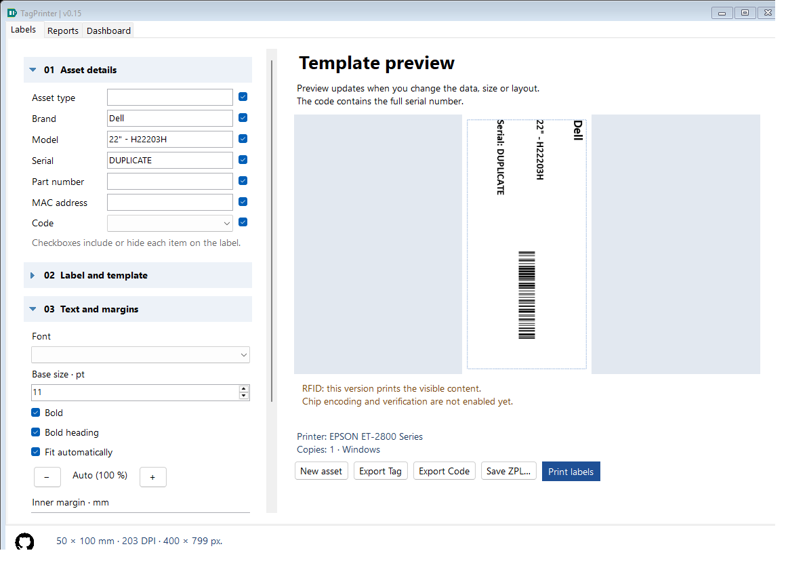
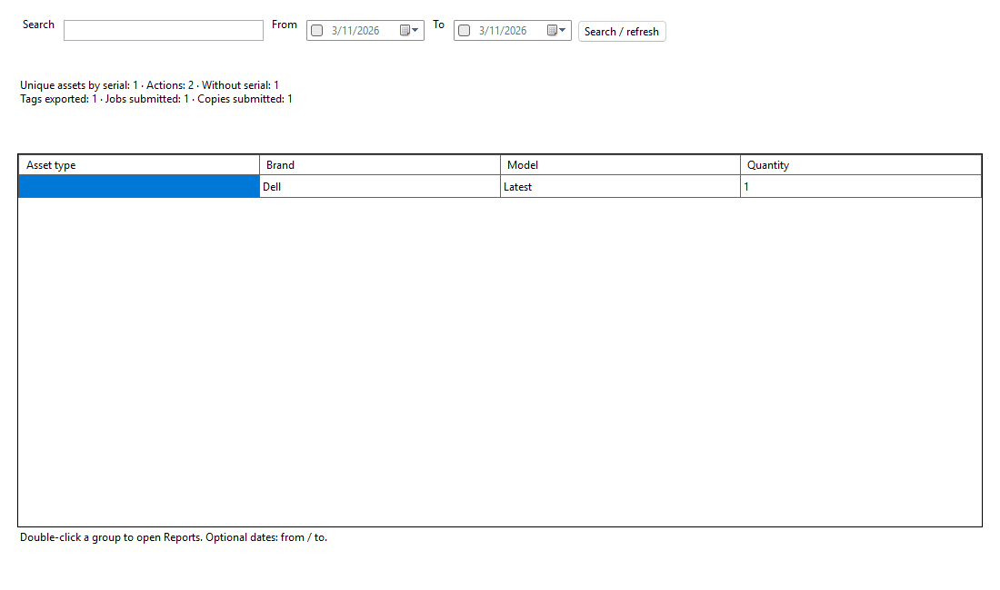

# Guía de uso — TagPrinter 0.13

## Abrir

Extrae todo el ZIP portable y abre TagPrinter.exe. Conserva sus archivos y carpetas, incluido config.json. Incluye .NET. Para imprimir se requiere el controlador Windows de la impresora.

## Datos del activo

Tipo de activo / Asset type, Marca / Brand, Modelo / Model, Serial, No. de parte / Part number y Dirección MAC / MAC address. Las seis casillas comienzan marcadas para trabajos nuevos. Desmarcar oculta solo el texto y conserva el valor editable.

Si Código está activado, el serial es obligatorio y alimenta el QR o Code 128 incluso si ocultas su texto. Si desactivas Código, el serial puede estar vacío. No. de parte y MAC son opcionales; si están vacíos no consumen espacio en la etiqueta. MAC se imprime tal como se escribe; no se normaliza ni se valida como dirección de red en esta versión.

Los textos visibles se redistribuyen. Si desmarcas todos los textos y Código sigue marcado, queda únicamente el código. Sin código debe quedar al menos un texto visible con contenido. Seis campos pueden no caber en etiquetas pequeñas; usa un tamaño mayor o desmarca los que no necesitas. No se recortan textos silenciosamente.

## Secciones plegables

01 Datos del activo empieza expandida y también se puede contraer. 02 a 05 comienzan contraídas. Pulsa el encabezado o usa Enter/Espacio con el foco en él para expandir. Contraerlas no cambia sus valores.

- 01: filas compactas con campos, selector QR/Code 128 y checkbox Código a la derecha.
- 02: tamaño de etiqueta (ancho × alto), medidas personalizadas y distribución. Los tamaños vienen de config.json.
- 03: ajuste automático de texto o botones −/+ (manual, 50–200 %), margen 1–5 mm (inicial 2 mm), guía azul de vista previa y desplazamientos.
- 04: impresora instalada, método Windows/ZPL, 203/300 DPI y copias.
- 05 Configuración / Settings: idioma English / Español. La selección se aplica al instante y se conserva al reabrir.

La fuente se ajusta conjuntamente sin modificar el código. La guía no se imprime ni se exporta. Desplazamientos positivos mueven a la derecha/abajo; se bloquea la salida del área disponible.

## Exportación

**Export Tag / Exportar etiqueta** guarda la etiqueta completa como serial.png.

**Export Code / Exportar código** guarda únicamente el símbolo: serial_QR.png o serial_barcode.png. Usa fondo blanco opaco, zona blanca de lectura, escala entera y el DPI seleccionado; no depende de la fuente, márgenes ni distribución de la etiqueta.

**Save ZPL / Guardar ZPL** exporta la etiqueta completa como comandos gráficos para un dispositivo compatible. Los nombres de archivo sustituyen caracteres que Windows no permite.

## Impresión

Selecciona la impresora real instalada en Windows. El método Windows usa su controlador. Direct ZPL requiere que la unidad acepte ZPL. Configura material/calibración y verifica que el tamaño coincida. Imprime una muestra y escanea el código antes de un lote. Enviar a la cola no confirma impresión física. No se escribe RFID.

## Guardado automático

Los cambios se guardan tras 600 ms, al cerrar, exportar o imprimir. El formulario recupera el último trabajo; el historial independiente está en SQLite y se consulta en Reportes. Se conserva la ruta histórica %LOCALAPPDATA%\InventoryLabels\settings.json para compatibilidad.

Los antiguos Title / ShowTitle migran a Brand / ShowBrand sin borrar valores. Revisa la marca después de actualizar, ya que el contenido antiguo podría ser un tipo de equipo como «Monitor».

## Configuración general

[config.json: tamaños y valores iniciales](CONFIGURATION.md). Edita el archivo junto al EXE y reinicia. La aplicación no lo reescribe al guardar el trabajo.

Tipo de activo / Asset type aparece antes de Marca y tiene checkbox y autoguardado. Ejemplo: Monitor / Dell / H22203H / ABC123 / ZYX123 / 00:1A:2B:3C:4D:5E. El código representa ABC123. En trabajos existentes el nuevo campo empieza vacío para no inventar el tipo; completa su valor cuando corresponda.

El selector de idioma está en **05 Configuración / Settings**, contraída por defecto junto con 02, 03 y 04. Abre su encabezado para cambiarlo. La zona principal comienza con los datos del activo.

## v0.12: trabajo diario

**New asset / Nuevo activo** vacía los seis datos del activo y guarda el trabajo vacío, conservando impresora, copias, plantilla, idioma, tamaños, fuente, márgenes y checkboxes. No mantiene una copia del activo anterior ni un historial; exporta su etiqueta antes si necesitas conservarla.

El resumen junto a los botones muestra siempre impresora, copias y método Windows/ZPL, aunque 04 esté contraída. Se actualiza al cambiar opciones o idioma.

El icono de GitHub está siempre visible en la esquina inferior izquierda. Su tooltip es Acerca de / About y abre el repositorio al pulsarlo. Ya no está dentro de 05.

## v0.13: pestaña Reportes

Exporta una etiqueta o código, abre Reportes y busca su serial. La tabla admite filtros y ordenación. Pulsa el serial para recuperar el diseño y volver a Etiquetas, revisa y pulsa Imprimir. Usa Exportar vista CSV, Exportar todo CSV o Copia de seguridad. [Guía completa del historial](HISTORY.md). El historial comienza con nuevas operaciones de v0.13 y nunca implica confirmación de impresión física.

## v0.14: filas compactas y código opcional

Cada campo tiene su nombre, control y checkbox en la misma fila. Los checkboxes solo incluyen/ocultan el elemento en la etiqueta; no borran datos ni deshabilitan edición. Sus tooltips y nombres accesibles explican la acción.

En 01, la fila Código permite elegir QR/Code 128 y activar/desactivar su inclusión. Sin código, los textos usan toda el área y el serial puede estar vacío. Se bloquean las etiquetas completamente vacías. Vista previa, Export Tag, ZPL e impresión comparten ese diseño. Export Code es independiente: siempre genera un símbolo y necesita serial.

La selección se guarda y se recupera del historial. En Reportes las etiquetas sin serial muestran (Sin serial) / (No serial) como enlace; se recuperan por su ID, sin inventar un serial. Los datos anteriores siguen mostrando su código por defecto.

## v0.15 — Fuente, orientación, papelera y Dashboard

- Fuente instalada en Windows, tamaño base 4–72 pt, negrilla general y encabezado en negrilla independiente. El encabezado conserva proporción 1.3; ajuste automático y escala porcentual siguen disponibles. El tamaño efectivo puede reducirse con ajuste automático. Si falta la fuente al mover el portable, se usa Arial al recuperar el trabajo.
- En 02: horizontal/vertical intercambia ancho y alto y pasa a tamaño personalizado. Rotación del contenido 0/90/180/270 gira texto y código juntos dentro del tamaño físico elegido; no gira solo el texto. Vista previa, PNG, ZPL e impresión usan el mismo resultado. Export Code permanece independiente.
- Reportes permite seleccionar varias filas, Eliminar y confirmar. Papelera muestra los registros retirados y permite restaurarlos. No se borran archivos PNG/ZPL ni trabajos en la impresora. Backup incluye la papelera; CSV exporta registros activos o de la papelera según la vista.
- Dashboard muestra agrupaciones tipo + marca + modelo, activos únicos por serial (sin distinguir mayúsculas y con espacios extremos eliminados), acciones, exportaciones PNG de etiquetas, trabajos y copias enviados. Fechas y búsqueda limitan los eventos analizados: se toma el registro más reciente de cada serial dentro de esos resultados. Sin serial se informa aparte como cantidad de acciones, no de activos. Los registros en papelera no cuentan. Doble clic abre los registros del grupo en Reportes; la vista de detalle muestra todo su historial activo.
- Trabajos enviados y copias no confirman impresión física. El Dashboard representa historial de etiquetas, no inventario verificado. Identificadores reutilizados pueden representar activos distintos; por ahora un serial identifica un activo.
- Estado de formato recuperable en último trabajo y snapshots históricos. Registros antiguos conservan Arial 10 pt, encabezado resaltado y rotación 0. SQLite añade tabla trash sin alterar los registros anteriores. Los historiales grandes todavía se cargan en memoria.

